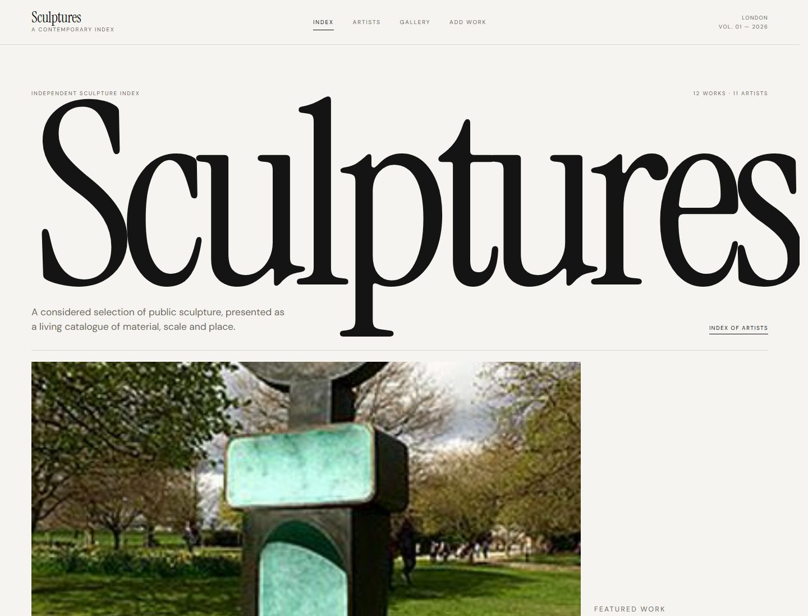
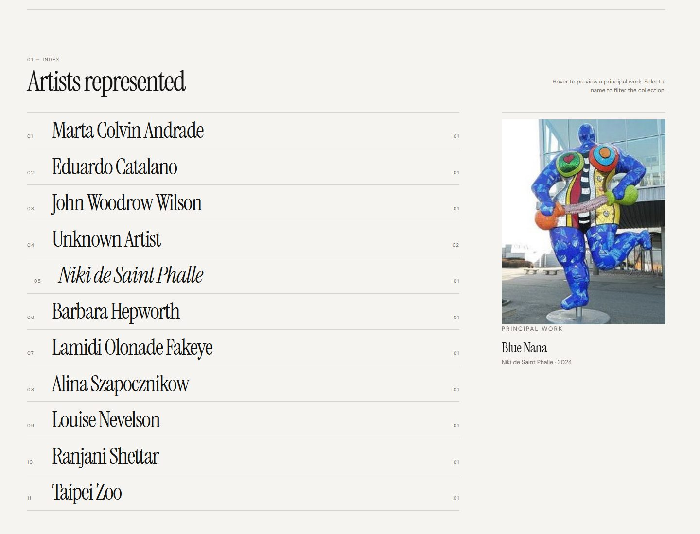
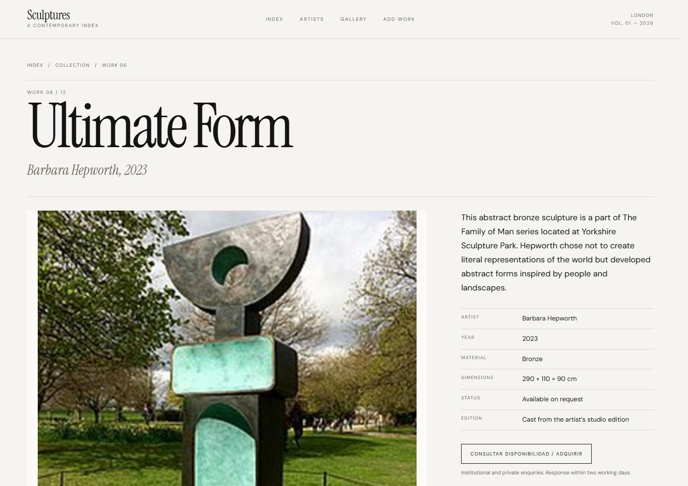
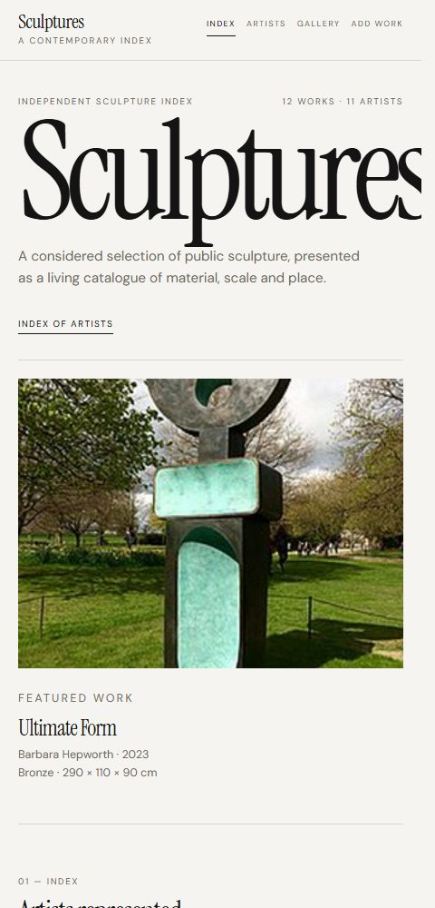

# Sculptures App — Práctica de CRUD con React

SPA para gestionar un catálogo de esculturas públicas. Es la resolución, paso a paso, del
ejercicio [`React Sculptures CRUD Practice`](docs/React%20Sculptures%20CRUD%20Practice.md):
un CRUD completo (Create, Read, Update, Delete) con navegación superior mediante
`react-router-dom` y una dirección de arte editorial inspirada en catálogos de galería
contemporánea.

## Funcionalidades

- CRUD completo sobre un catálogo de esculturas.
- Confirmación reutilizable antes de borrar o restaurar, con un `<dialog>` nativo.
- Borrado tanto desde el listado como desde el detalle, con vuelta al catálogo tras confirmar.
- Validación del formulario con errores en línea y foco en el primer campo inválido.
- Filtro por artista, nombre, año o descripción (`?field=year&q=2024`), insensible a mayúsculas
  y acentos. Los enlaces antiguos `?artist=hepworth` siguen funcionando.
- Dos vistas conmutables: catálogo completo o paginado de seis en seis, con el estado en la URL
  (`/?view=pages&page=2`).
- Galería en `/gallery` para recorrer el catálogo de una en una: Previous/Next con **Loop**
  opcional, miniaturas, like por escultura, año, fondos, animación y descripción
  expandible.
- Portada editorial con titular a ancho completo, obra destacada e índice de artistas con
  vista previa al pasar el ratón o al enfocar un nombre.
- Ficha de museo en `/sculptures/:id` con material, medidas, estado, biografía breve del
  artista y un enlace sutil de consulta de disponibilidad.
- Catálogo persistido en **Neon Postgres** y consumido con **Neon Data API** y
  **Neon Auth anónimo** a través del hook `useSculptures`.
- Estados de carga, error de conexión y error de acción con reintento desde la interfaz.
- Dirección de arte en piedra cálida, tinta y líneas de 1px, con transiciones fluidas y
  soporte para `prefers-reduced-motion`.

## Stack

- **React 19** con componentes funcionales y hooks.
- **Vite 8** como bundler y servidor de desarrollo.
- **react-router-dom 7** para las rutas.
- **@neondatabase/neon-js 0.9** para Auth anónimo y consultas PostgREST contra Neon.
- **Google Fonts** con **Instrument Serif** para titulares y **DM Sans** para la interfaz.
- **ESLint 10** (flat config) para el análisis estático.
- JavaScript (sin TypeScript), tal como propone el enunciado.

## Puesta en marcha

La aplicación necesita un proyecto de Neon con Auth anónimo y Data API habilitados.

1. Copia las variables de entorno de ejemplo:

   ```bash
   cp .env.example .env          # macOS / Linux
   Copy-Item .env.example .env   # Windows PowerShell
   ```

2. Rellena en `.env` las dos URLs de tu proyecto:

   ```bash
   VITE_NEON_AUTH_URL=https://ep-xxx.neonauth.<region>.aws.neon.tech/neondb/auth
   VITE_NEON_DATA_API_URL=https://ep-xxx.apirest.<region>.aws.neon.tech/neondb/rest/v1
   ```

   `VITE_NEON_AUTH_URL` es la URL de **Neon Auth** y `VITE_NEON_DATA_API_URL` la del
   **Data API** (host `apirest`, ruta `/neondb/rest/v1`). No confundas esta última con el
   endpoint JWKS de Auth (`/.well-known/jwks.json`).

3. Abre el **SQL Editor** de Neon y ejecuta completo [`db/schema.sql`](db/schema.sql). El
   script crea la tabla, los permisos del rol `anonymous`, las políticas RLS, inserta las 12
   obras iniciales y recarga la caché de esquema de PostgREST.

4. Instala y arranca:

   ```bash
   npm install
   npm run dev
   ```

La aplicación queda disponible en `http://localhost:5173`.

Otros comandos:

```bash
npm run lint      # análisis estático
npm run build     # build de producción
npm run preview   # previsualizar el build
```

## Backend: Neon

El catálogo ya no vive en `localStorage`: la base de datos es la única fuente de verdad.

- **Tabla:** `public.sculptures` con `id`, `name`, `artist`, `description`, `year`,
  `location`, `url`, `alt`, `material`, `dimensions`, `created_at` y `updated_at`.
  Mantiene el contrato del wiki (tabla, permisos y políticas RLS) y añade `material`,
  `dimensions` y marcas de tiempo para la ficha editorial. `year` queda opcional para
  admitir obras sin fecha documentada; el resto de columnas obligatorias coincide con la
  guía.
- **Cliente:** [`src/neon.js`](src/neon.js) crea el cliente con
  `createClient({ auth: { url, allowAnonymous: true }, dataApi: { url } })`.
- **Estado y CRUD:** [`src/SculpturesContext.jsx`](src/SculpturesContext.jsx) reúne las
  cinco piezas de la guía (`unwrap`, `SculptureApiService`, `SculpturesContext`,
  `SculpturesProvider` y `useSculptures`) y exporta solo el provider y el hook. El hook
  expone `sculptures`, `loading`, `error`, `actionError`, `reload`, `addSculpture`,
  `updateSculpture`, `removeSculpture` y `resetSculptures`.
- **Consultas:** el SDK usa la sintaxis de PostgREST
  (`.from('sculptures').select('*').order('id', { ascending: true })`,
  `.insert(row).select()`, `.update(row).eq('id', id).select()`, `.delete().eq('id', id)`).
- **Recarga del esquema:** tras ejecutar el SQL, `NOTIFY pgrst, 'reload schema'` hace que el
  Data API vea la tabla sin reiniciar el proyecto.

### Consumir la base desde otros programas

Neon es PostgreSQL estándar, así que el catálogo no queda atado a esta SPA:

- **SQL / drivers:** usa la cadena de conexión de Neon (`DATABASE_URL`) con `psql`, DBeaver,
  Java/JDBC, Python, Node, etc.
- **HTTP:** el Data API expone la misma tabla como REST en
  `https://ep-xxx.apirest.<region>.aws.neon.tech/neondb/rest/v1/sculptures`. Se puede
  consultar con `fetch`, `curl` o cualquier cliente HTTP enviando el token de Auth que
  corresponda.
- **Auth:** las escrituras anónimas funcionan porque el rol `anonymous` tiene permisos. Para
  otros clientes conviene crear sus propios roles o usar `authenticated`.

### Seguridad

El esquema de práctica permite `SELECT`, `INSERT`, `UPDATE` y `DELETE` al rol `anonymous`
para que el CRUD funcione sin registro. Es cómodo para aprender, pero **no es apto para
producción**: cualquiera con la URL podría modificar el catálogo. Antes de publicar, limita
las escrituras al rol `authenticated`, añade políticas RLS por usuario y mantén la
configuración local fuera del repositorio (`.env` está ignorado por Git).

## Dirección de arte

El rediseño parte de una idea de catálogo impreso de lujo: una retícula amplia, líneas
ultrafinas y una tipografía con contraste. La página se organiza como una portada de
galería, no como un panel de administración.

- **Paleta:** piedra cálida `#F5F4F0`, tinta `#141414` y líneas `#D8D6CE`. El papel de las
  imágenes es `#FBFAF7`.
- **Tipografía:** Instrument Serif para el titular, los títulos de obra y las biografías;
  DM Sans para navegación, etiquetas y controles.
- **Sin adornos:** no hay `box-shadow` ni degradados. La jerarquía sale de la escala, el
  espacio en blanco y las divisorias de 1px.
- **Portada:** el nombre de la galería ocupa el ancho útil, seguido de una obra destacada y
  del índice de artistas. Al pasar el ratón o enfocar un nombre, el panel lateral muestra su
  obra principal; al pulsarlo, se filtra la colección.
- **Ficha de obra:** imagen de gran formato, medidas, material, estado, edición y una
  biografía breve del artista, con el enlace «Consultar disponibilidad / Adquirir».
- **Movimiento:** transiciones cortas de opacidad, escala y desplazamiento. Con
  `prefers-reduced-motion` se desactivan.

## Capturas del rediseño

**Portada de escritorio** — el nombre de la galería ocupa todo el ancho útil, seguido de la
obra destacada.



**Índice de artistas** — vista previa de la obra principal al pasar el ratón por Niki de
Saint Phalle.



**Ficha de museo** — imagen de gran formato, descripción, material, medidas y el enlace
«Consultar disponibilidad / Adquirir».



**Vista móvil** — la misma jerarquía editorial en una sola columna.



## Estructura del proyecto

```
sculptures-app/
├── db/
│   └── schema.sql         # tabla, permisos, RLS y datos iniciales para Neon
├── docs/
│   ├── bitacora/          # diario de desarrollo, una entrada por parte o bonus
│   ├── learn/             # material de estudio y guía de conceptos
│   └── ...                # enunciado y capturas del proceso
├── public/                # favicon e iconos estáticos
├── src/
│   ├── assets/            # imágenes del template de Vite (sin usar)
│   ├── components/        # ConfirmDialog, Pagination y SculpturesGallery
│   ├── pages/             # Layout, listado, detalle, formulario, galería y 404
│   ├── App.jsx            # router y composición de la aplicación
│   ├── App.css            # estilos de la portada, la colección y las fichas
│   ├── index.css          # estilos globales y variables de la dirección de arte
│   ├── data.js            # dataset inicial de esculturas y semilla de Neon
│   ├── data/
│   │   └── editorial.js   # materiales, medidas y biografías de la ficha
│   ├── neon.js            # cliente de Neon Auth + Data API
│   ├── SculpturesContext.jsx # provider, contexto y hook (cinco piezas de la guía)
│   └── main.jsx           # punto de entrada
├── .env.example           # plantilla de variables de Neon
├── index.html
├── vite.config.js
└── eslint.config.js
```

## Estado del ejercicio

| Parte | Contenido                                     | Estado | Bitácora                                                    |
| ----- | --------------------------------------------- | ------ | ----------------------------------------------------------- |
| 1     | Scaffold del proyecto con Vite                | ✅     | [Parte 1](docs/bitacora/parte-01-scaffold.md)               |
| 2     | Preparar los datos (`src/data.js`)            | ✅     | [Parte 2](docs/bitacora/parte-02-datos.md)                  |
| 3     | Pensar el diseño antes de codificar           | ✅     | [Parte 3](docs/bitacora/parte-03-diseno.md)                 |
| 4     | Rutas, navegación y estética                  | ✅     | [Parte 4](docs/bitacora/parte-04-rutas-nav.md)              |
| 5     | Read: listado y detalle                       | ✅     | [Parte 5](docs/bitacora/parte-05-read.md)                   |
| 6     | Create + Update con un formulario compartido  | ✅     | [Parte 6](docs/bitacora/parte-06-create-update.md)          |
| 7     | Delete y restaurar catálogo                   | ✅     | [Parte 7](docs/bitacora/parte-07-delete.md)                 |
| Bonus | Confirmación de borrado y restauración        | ✅     | [Bonus 1](docs/bitacora/bonus-01-confirmacion-borrado.md)   |
| Bonus | Validación del formulario                     | ✅     | [Bonus 2](docs/bitacora/bonus-02-validacion-formulario.md)  |
| Bonus | Filtro por artista con `useSearchParams`      | ✅     | [Bonus 3](docs/bitacora/bonus-03-filtro-artista.md)         |
| Bonus | `useSculptures` y persistencia local (histórico) | ✅     | [Bonus 4](docs/bitacora/bonus-04-hook-localstorage.md)      |
| Bonus | Borrado desde el detalle                     | ✅     | [Bonus 5](docs/bitacora/bonus-05-borrado-detalle.md)        |
| Anexo | Vista paginada con conmutador                 | ✅     | [Anexo 1](docs/bitacora/anexo-01-vista-paginada.md)         |
| Anexo | Filtro por campo seleccionable                | ✅     | [Anexo 2](docs/bitacora/anexo-02-filtro-por-campo.md)       |
| Anexo | Galería con las diez ideas de `exercise.md`   | ✅     | [Anexo 3](docs/bitacora/anexo-03-galeria.md)                |
| Backend | Neon Data API + Auth anónimo                | ✅     | [Backend: Neon](#backend-neon)                              |
| Diseño | Rediseño editorial y ficha de museo           | ✅     | [Dirección de arte](#dirección-de-arte)                     |

## Bitácora de desarrollo

Cada parte del ejercicio tiene su propia entrada con el análisis, las decisiones tomadas y
los cambios realizados:

- [Parte 1 — Crear el proyecto con Vite](docs/bitacora/parte-01-scaffold.md)
- [Parte 2 — Preparar los datos](docs/bitacora/parte-02-datos.md)
- [Parte 3 — Pensar el diseño antes de codificar](docs/bitacora/parte-03-diseno.md)
- [Parte 4 — Rutas, navegación y estética](docs/bitacora/parte-04-rutas-nav.md)
- [Parte 5 — Read: listado y detalle](docs/bitacora/parte-05-read.md)
- [Parte 6 — Create + Update: un formulario compartido](docs/bitacora/parte-06-create-update.md)
- [Parte 7 — Delete](docs/bitacora/parte-07-delete.md)
- [Bonus 1 — Confirmar el borrado con un modal](docs/bitacora/bonus-01-confirmacion-borrado.md)
- [Bonus 2 — Validación del formulario](docs/bitacora/bonus-02-validacion-formulario.md)
- [Bonus 3 — Filtro por artista con `useSearchParams`](docs/bitacora/bonus-03-filtro-artista.md)
- [Bonus 4 — `useSculptures` y `localStorage`](docs/bitacora/bonus-04-hook-localstorage.md)
- [Bonus 5 — Borrado desde el detalle](docs/bitacora/bonus-05-borrado-detalle.md)
- [Anexo 1 — Vista paginada con conmutador](docs/bitacora/anexo-01-vista-paginada.md)
- [Anexo 2 — Filtro por campo seleccionable](docs/bitacora/anexo-02-filtro-por-campo.md)
- [Anexo 3 — Galería con las diez ideas](docs/bitacora/anexo-03-galeria.md)

## Material de estudio

La carpeta [`docs/learn/`](docs/learn/) reúne apuntes y una guía de los conceptos que aparecen
en la práctica:

- [Guía de estudio de los bonus y anexos](docs/learn/README.md): `<dialog>`, validación, `useSearchParams`,
  filtros por campo, hooks con `localStorage`, paginación, borrado desde el detalle y la galería
  con estado local, con preguntas para repasar.
- [Apuntes de React](docs/learn/React_estudio16112026.pdf) y capturas de estudio.

## Próximos pasos

La práctica principal, los bonus y los anexos están completos. Como mejoras opcionales quedarían:

- Mantener el filtro, la vista y la página al crear o editar una escultura.
- Persistir los likes de la galería si deben sobrevivir a una recarga.
- Restringir las escrituras al rol `authenticated` y añadir edición por usuario.
- Añadir búsqueda en servidor (`.ilike`, `.range`) cuando el catálogo crezca.

## Créditos

- Datos de las esculturas: [`AlbertProfe/sculptures`](https://github.com/AlbertProfe/sculptures),
  basados en el ejemplo de la documentación de React.
- Enunciado de la práctica: [`docs/React Sculptures CRUD Practice.md`](docs/React%20Sculptures%20CRUD%20Practice.md).
- Enunciado de la galería: [`docs/exercise.md`](docs/exercise.md).
- Tipografías: [Instrument Serif](https://fonts.google.com/specimen/Instrument+Serif) y
  [DM Sans](https://fonts.google.com/specimen/DM+Sans), servidas por Google Fonts.
