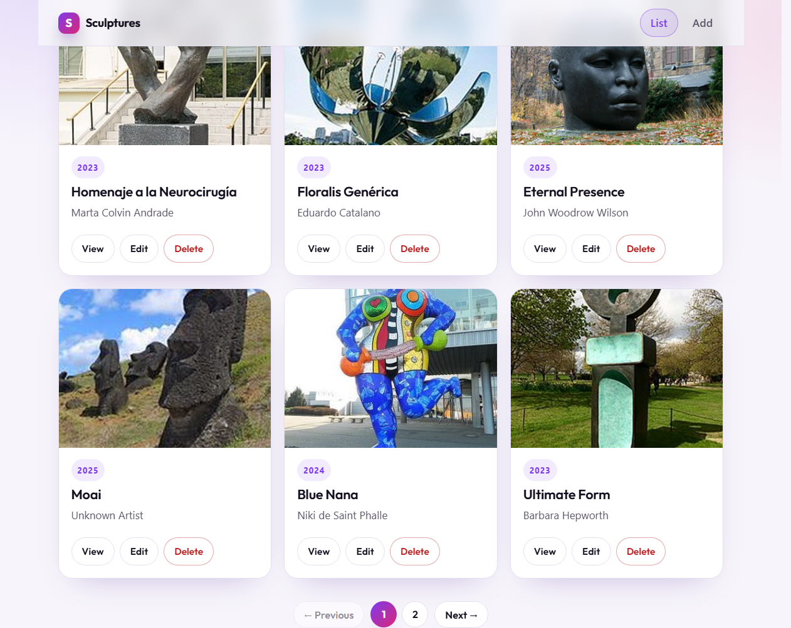

# Anexo 1 — Vista paginada con conmutador

## Qué añade este anexo

La práctica mostraba siempre las doce esculturas de golpe. El anexo añade una segunda forma de
ver el catálogo: la misma rejilla, pero repartida en páginas de seis tarjetas. Un conmutador
**All / Pages** permite pasar de una vista a otra sin recargar y sin perder el filtro por artista.

El estado no vive en un `useState` escondido: la vista y la página están en la URL.

```text
/                              → catálogo completo
/?view=pages                   → vista paginada, página 1
/?view=pages&page=2            → vista paginada, página 2
/?view=pages&artist=hepworth   → filtro dentro de la vista paginada
```

Así el enlace se puede compartir y los botones Atrás/Adelante del navegador funcionan como se
espera.

## Punto de partida

`SculptureListPage` ya derivaba el filtro de la URL con `useSearchParams` y dibujaba
`visibleSculptures` directamente en la rejilla. No había ninguna noción de página ni de vista.

## Implementación

### 1. Derivar la página, sin duplicar estado

Todo se calcula a partir del array filtrado y de los parámetros:

```jsx
const PAGE_SIZE = 6

const viewMode = searchParams.get('view') === 'pages' ? 'pages' : 'all'
const totalPages = Math.max(1, Math.ceil(visibleSculptures.length / PAGE_SIZE))
const requestedPage = Number(searchParams.get('page') ?? '1')
const currentPage =
  Number.isInteger(requestedPage) && requestedPage >= 1
    ? Math.min(requestedPage, totalPages)
    : 1
const pageStart = (currentPage - 1) * PAGE_SIZE
const listedSculptures =
  viewMode === 'pages'
    ? visibleSculptures.slice(pageStart, pageStart + PAGE_SIZE)
    : visibleSculptures
```

La rejilla recibe `listedSculptures`, no `visibleSculptures`. En la vista completa son el mismo
array; en la paginada, solo el trozo de la página actual.

### 2. Mantener la URL honesta

Si un enlace llega con `page=99`, o si un borrado elimina la última tarjeta de la última página,
la página calculada se limita a la última válida. Pero la barra de direcciones seguiría diciendo
`page=99`. Un efecto la corrige con `replace`:

```jsx
useEffect(() => {
  if (viewMode !== 'pages') return

  const rawPage = searchParams.get('page')
  if (rawPage === null || rawPage === String(currentPage)) return

  const next = new URLSearchParams(searchParams)
  if (currentPage === 1) {
    next.delete('page')
  } else {
    next.set('page', String(currentPage))
  }
  setSearchParams(next, { replace: true })
}, [currentPage, searchParams, setSearchParams, viewMode])
```

La primera comprobación es la importante: si no hay nada que corregir, el efecto termina. Sin
esa guarda, escribir la URL volvería a disparar el efecto una y otra vez.

### 3. Cambiar de vista y de página

```jsx
function changeView(mode) {
  if (mode === viewMode) return

  const next = new URLSearchParams(searchParams)

  if (mode === 'pages') {
    next.set('view', 'pages')
    next.delete('page')
  } else {
    next.delete('view')
    next.delete('page')
  }

  setSearchParams(next)
}

function goToPage(page) {
  const next = new URLSearchParams(searchParams)
  next.set('view', 'pages')

  if (page === 1) {
    next.delete('page')
  } else {
    next.set('page', String(page))
  }

  setSearchParams(next)
}
```

Al entrar en la vista paginada se empieza por la página 1. La página 1 no se escribe en la URL:
`?view=pages` ya la implica, y la barra queda más limpia.

### 4. El componente `Pagination`

Lo extraje a `src/components/Pagination.jsx` para que la página del listado no se llene de
botones. Recibe `page`, `totalPages` y `onChange`:

```jsx
<nav className="pagination" aria-label="Pagination">
  <button type="button" onClick={() => onChange(page - 1)} disabled={page === 1}>
    ← Previous
  </button>

  <ul className="pagination-pages">
    {pages.map((number) => (
      <li key={number}>
        <button
          type="button"
          onClick={() => onChange(number)}
          aria-label={`Go to page ${number}`}
          aria-current={number === page ? 'page' : undefined}
        >
          {number}
        </button>
      </li>
    ))}
  </ul>

  <button
    type="button"
    onClick={() => onChange(page + 1)}
    disabled={page === totalPages}
  >
    Next →
  </button>
</nav>
```

Si `totalPages` es 1, el componente devuelve `null`. No tiene sentido enseñar un paginador con
un solo botón.

### 5. El resumen también cambia

En la vista completa, con filtro, el resumen ya decía “Showing 1 of 12 sculptures matching…”. En
la paginada conviene saber qué tramo se está viendo:

```text
Showing 1–6 of 12 sculptures.
Showing 7–12 of 12 sculptures.
Showing 1–1 of 1 sculpture matching “colvin”.
```

El texto sigue dentro de un `role="status"`, así que se anuncia al cambiar de página o de filtro.

## Decisiones

- **Seis por página.** En escritorio son dos filas de tres tarjetas: una página completa sin
  obligar a hacer scroll para ver el paginador. En móvil son seis tarjetas en columna, que sigue
  siendo una cantidad razonable.
- **La URL como fuente de verdad.** Igual que el filtro del Bonus 3. Guardar la página en un
  `useState` obligaría a sincronizarla con la URL y con el filtro; derivarla evita estados
  imposibles.
- **Cambiar de página no usa `replace`.** Quiero que Atrás vuelva a la página anterior. Escribir
  en el filtro sí usa `replace`, porque cada tecla no debe crear una entrada de historial.
- **Cambiar de vista empieza en la página 1.** Mantener la página al volver de “Pages” a “All” y
  otra vez a “Pages” sería recordar un estado que el usuario no ve. Empezar en 1 es predecible.
- **El filtro manda antes que la paginación.** Primero se filtra y luego se reparte el resultado.
  Si el filtro deja tres coincidencias, hay una sola página y el paginador desaparece.
- **Cambiar el filtro vuelve a la página 1.** Si estabas en la página 2 y filtras, la página 2
  del nuevo resultado no tiene por qué existir. Borrar `page` es más simple que intentar
  conservarla.
- **Borrar no rompe la página.** Si eliminas la última tarjeta de la última página, el cálculo se
  limita a la última página válida y el efecto limpia la URL. Nunca se ve una rejilla vacía con un
  paginador que apunta a una página inexistente.
- **El contador grande sigue siendo el total del catálogo.** “12 sculptures in the catalogue” no
  cambia al paginar. El resumen debajo es el que explica qué tramo se ve.
- **Una sola rejilla para las dos vistas.** No hay dos componentes de listado que puedan
  desincronizarse; solo cambia el array que recibe.
- **El paginador se oculta con una sola página.** Menos ruido visual y menos controles inútiles.

## Fallos que encontré

### Mi primera comprobación esperaba un paginador que no debía existir

Al probar el borrado dejé seis esculturas, es decir, exactamente una página. Mi script buscaba
`.pagination-number[aria-current="page"]` y fallaba porque el componente devuelve `null` cuando
`totalPages <= 1`.

No era un fallo de la aplicación: era una expectativa mía equivocada. Corregí la prueba para
comprobar que, con una sola página, el paginador desaparece y quedan las seis tarjetas. La
lección es que también hay que probar el caso “no hay nada que paginar”, no solo el camino feliz.

### El efecto de corrección podía entrar en bucle

Mi primer esbozo llamaba a `setSearchParams` siempre que la página calculada no coincidiera con
la de la URL. Si la URL no traía `page`, `rawPage` era `null` y la condición se cumplía en cada
render: el efecto reescribía la URL una y otra vez.

La solución fue comprobar primero si hay algo que corregir:

```jsx
if (rawPage === null || rawPage === String(currentPage)) return
```

Con esa salida temprana, el efecto solo actúa cuando la URL pide una página fuera de rango o no
numérica. Es el tipo de detalle que no se ve en pantalla hasta que la aplicación empieza a
parpadear.

## Verificación

`npm run lint` y `npm run build` pasan.

Probé el conmutador, la paginación, el historial, los enlaces directos, el filtro combinado y el
borrado de la última tarjeta de la última página con Chrome headless:

```text
inicio: vista completa, 12 tarjetas: true
inicio: sin paginador y sin parámetros: true
inicio: "All" marcado y "Pages" no: true
paginar: URL ?view=pages: true
paginar: 6 tarjetas: true
paginar: primera página marcada: true
paginar: Previous deshabilitado: true
paginar: resumen 1–6 de 12: true
página 2: URL ?view=pages&page=2: true
página 2: 6 tarjetas y empieza por Cavaliere: true
página 2: resumen 7–12: true
página 2: Next deshabilitado: true
atrás: vuelve a la página 1: true
enlace directo a la página 2: true
página fuera de rango: corrige la URL a 2: true
filtrar en páginas: conserva view y quita page: true
filtrar en páginas: resumen y sin paginador: true
volver a All: conserva el filtro y quita view: true
limpiar filtro: 12 tarjetas y URL vacía: true
cambiar filtro desde la página 2 vuelve a la 1: true
7 elementos: página 2 con 1 tarjeta: true
borrar deja 6 y recoloca en la página 1: true
el borrado persiste y la página queda limpia: true
con 6 elementos: All muestra 6 y oculta el paginador: true
estado final: 12 tarjetas, vista All y 12 guardadas: true
```

También revisé el resultado en modo claro, oscuro y en una pantalla estrecha. Así se ve la vista
paginada con el paginador al final:



## Limitación conocida

Al crear o editar una escultura, el formulario navega a `/` y se pierde la vista paginada y la
página. Conservarlas exigiría pasar la URL de vuelta al formulario o usar `navigate(-1)`. Lo dejé
anotado en los próximos pasos del README: es una mejora independiente de este anexo.

## Fuentes

- `useSearchParams` de React Router: https://reactrouter.com/api/hooks/useSearchParams
- `URLSearchParams`: https://developer.mozilla.org/en-US/docs/Web/API/URLSearchParams
- `Array.prototype.slice`: https://developer.mozilla.org/en-US/docs/Web/JavaScript/Reference/Global_Objects/Array/slice
- `Math.ceil` y `Math.min`: https://developer.mozilla.org/en-US/docs/Web/JavaScript/Reference/Global_Objects/Math
- `aria-current`: https://developer.mozilla.org/en-US/docs/Web/Accessibility/ARIA/Reference/Attributes/aria-current
- `useEffect` y dependencias: https://react.dev/reference/react/useEffect
- Paginación accesible (patrón de navegación): https://www.w3.org/WAI/ARIA/apg/patterns/
