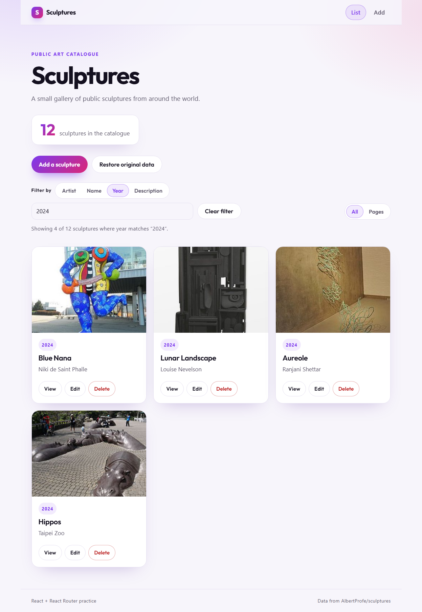

# Anexo 2 — Filtro por campo seleccionable

## Qué añade este anexo

Hasta ahora el buscador solo filtraba por artista. El anexo permite elegir el campo con unos
botones —**Artist, Name, Year, Description**— y aplicar la misma caja de búsqueda al campo
seleccionado. Sin desplegables y sin cambiar el resto del listado: siguen conviviendo el filtro,
el conmutador All/Pages y la paginación.

```text
Filter by  [Artist] [Name] [Year] [Description]
[ e.g. 2023________________ ]  [Clear filter]
```

La URL sigue siendo la fuente de verdad. El esquema nuevo es `field` + `q`:

```text
/?q=colvin                     → artista (valor por defecto)
/?field=name&q=moai            → nombre
/?field=year&q=2024            → año
/?field=description&q=bronze   → descripción
/?artist=colvin                → enlace heredado del Bonus 3, sigue funcionando
```

## Punto de partida

El Bonus 3 guardaba la consulta en `?artist=` y filtraba siempre con `sculpture.artist`. La
paginación del Anexo 1 ya se apoyaba en esa búsqueda, así que había que ampliar el filtro sin
romper ni los enlaces antiguos ni la combinación con `view` y `page`.

## Implementación

### 1. Una lista de campos, no un `if` por campo

Cada campo sabe cómo extraer su valor de una escultura:

```jsx
const FILTER_FIELDS = [
  {
    id: 'artist',
    label: 'Artist',
    placeholder: 'e.g. Hepworth',
    getValue: (sculpture) => sculpture.artist,
  },
  {
    id: 'name',
    label: 'Name',
    placeholder: 'e.g. Moai',
    getValue: (sculpture) => sculpture.name,
  },
  {
    id: 'year',
    label: 'Year',
    placeholder: 'e.g. 2023',
    getValue: (sculpture) => String(sculpture.year ?? ''),
  },
  {
    id: 'description',
    label: 'Description',
    placeholder: 'e.g. bronze',
    getValue: (sculpture) => sculpture.description ?? '',
  },
]
```

Añadir un campo nuevo es añadir un objeto a la lista; la interfaz, el filtrado y el resumen se
actualizan solos.

### 2. Leer el campo y la consulta de la URL

```jsx
const rawField = searchParams.get('field')
const activeField =
  FILTER_FIELDS.find((option) => option.id === rawField) ?? FILTER_FIELDS[0]

// Compatibilidad: los enlaces antiguos ?artist=colvin siguen funcionando.
const filterQuery =
  searchParams.get('q') ??
  (rawField === null ? searchParams.get('artist') : null) ??
  ''
```

Si `field` no existe o no es uno de los cuatro identificadores, se usa Artist. Así un enlace
manipulado no rompe la página.

El filtrado usa el `getValue` del campo activo y la misma normalización del Bonus 3:

```jsx
const visibleSculptures = hasFilter
  ? sculptures.filter((sculpture) =>
      normalize(activeField.getValue(sculpture)).includes(
        normalize(trimmedQuery),
      ),
    )
  : sculptures
```

### 3. Cambiar de campo

Al cambiar de campo se limpia la consulta y se vuelve a la primera página:

```jsx
function changeFilterField(fieldId) {
  if (fieldId === activeField.id) return

  const next = new URLSearchParams(searchParams)
  next.delete('artist')
  next.delete('q')
  next.delete('page')

  if (fieldId === 'artist') {
    next.delete('field')
  } else {
    next.set('field', fieldId)
  }

  setSearchParams(next, { replace: true })
}
```

Artist es el campo por defecto, así que no se escribe `field=artist` en la URL. Los demás sí,
aunque la consulta esté vacía, para que el enlace recuerde qué campo está seleccionado.

Escribir en la caja mantiene el campo y normaliza el enlace heredado:

```jsx
function updateFilterQuery(value) {
  const next = new URLSearchParams(searchParams)

  next.delete('artist') // ?artist=... pasa a ser ?q=...
  next.delete('page')

  if (value.trim()) {
    next.set('q', value)
  } else {
    next.delete('q')
  }

  if (activeField.id === 'artist') {
    next.delete('field')
  } else {
    next.set('field', activeField.id)
  }

  setSearchParams(next, { replace: true })
}
```

### 4. Los botones

```jsx
<div className="filter-fields-row">
  <span className="form-label" id="filter-field-label">
    Filter by
  </span>
  <div
    className="filter-fields"
    role="group"
    aria-labelledby="filter-field-label"
  >
    {FILTER_FIELDS.map((field) => (
      <button
        className="filter-field"
        key={field.id}
        type="button"
        aria-pressed={activeField.id === field.id}
        onClick={() => changeFilterField(field.id)}
      >
        {field.label}
      </button>
    ))}
  </div>
</div>
```

La caja de búsqueda no necesita un `<label>` visible duplicado: su `aria-label` y su
`placeholder` cambian con el campo.

```jsx
<input
  id="catalogue-filter"
  value={filterQuery}
  onChange={(event) => updateFilterQuery(event.target.value)}
  placeholder={activeField.placeholder}
  aria-label={`Filter by ${fieldName}`}
  type="search"
/>
```

### 5. Resumen y estado vacío

El resumen nombra el campo para que no haya dudas de qué se está filtrando:

```text
Showing 4 of 12 sculptures where year matches “2024”.
Showing 1–6 of 10 sculptures where name matches “a”.
No sculptures where year matches “1999”.
```

Sigue dentro de `role="status"` y se combina con el tramo de la vista paginada.

## Decisiones

- **Botones, no un `<select>`.** Lo pedía el ejercicio y además encaja con el conmutador All/Pages:
  dos grupos de botones con el mismo lenguaje visual (`aria-pressed`, mismo componente de píldora).
- **Un solo par `field` + `q`, no un parámetro por campo.** Con `artist=`, `name=` y `year=` a la
  vez habría que decidir cuál gana y limpiar los otros en cada cambio. Un campo activo y una
  consulta no tienen ambigüedad.
- **Compatibilidad con `?artist=`.** Los enlaces y la documentación del Bonus 3 siguen siendo
  válidos. Al primer cambio, la URL se normaliza al esquema nuevo.
- **Artist por defecto.** Es el filtro que ya existía y el más habitual en un catálogo de arte.
  Por eso `?q=colvin` basta para buscar por artista.
- **Year, no Date.** El modelo de datos guarda un año (`2024`), no una fecha completa. La etiqueta
  del botón dice lo que realmente contiene el campo.
- **La consulta se limpia al cambiar de campo.** Mantener “Hepworth” al pasar a Year daría cero
  resultados y parecería un error. Empezar en blanco es más predecible.
- **Limpiar el filtro conserva el campo.** Si estabas en Description, “Clear filter” vacía la
  consulta pero te deja en Description para escribir otra búsqueda.
- **Coincidencia parcial también en Year.** `202` encuentra 2023, 2024 y 2025. Es coherente con el
  resto de campos y útil mientras se escribe. Si algún día se quiere un año exacto, se cambia en
  `getValue` o en la comparación, sin tocar la interfaz.
- **Se ignoran los campos desconocidos.** `?field=foo` cae en Artist en lugar de romper.
- **El filtro sigue aplicándose antes de paginar.** Cambiar de campo o de consulta borra `page`
  para no quedarse en una página que ya no existe.

## Fallos que encontré

### La ambigüedad de varios parámetros de filtro

Mi primera idea fue conservar `?artist=` y añadir `?name=`, `?year=` y `?description=`. Funciona,
pero si un enlace trae dos a la vez —por ejemplo `?artist=colvin&name=moai`— hay que inventar una
prioridad y decidir cuál se borra al cambiar de campo. Era más lógica de la necesaria.

Lo resolví con un único campo activo (`field`) y una única consulta (`q`). El enlace antiguo se
lee como caso especial y se normaliza en cuanto el usuario toca el filtro.

### Errores transitorios del servidor de desarrollo

Mientras hacía los cambios en caliente, Vite mostró varias veces
`ReferenceError: artistFilter is not defined`: estaba editando la parte de arriba del componente y
la de abajo al mismo tiempo, y el HMR aplicó un estado intermedio. El archivo final compilaba y
`npm run lint` pasaba, pero la pestaña se quedó con el error hasta reiniciar el servidor.

Me ha pasado ya un par de veces en esta práctica. La conclusión es la misma: cuando un cambio
pequeño “no hace nada” o aparece un error que el archivo ya no contiene, reiniciar Vite antes de
buscar el fallo en el código.

## Verificación

`npm run lint` y `npm run build` pasan.

Probé los cuatro campos, la compatibilidad, los enlaces directos, la paginación combinada y los
estados vacíos con Chrome headless:

```text
inicio: cuatro campos y Artist activo: true
inicio: 12 tarjetas, sin resumen, etiqueta accesible: true
enlace antiguo ?artist=colvin: filtra y mantiene Artist: true
al escribir normaliza el enlace a ?q=: true
cambiar a Name limpia la consulta y conserva el campo: true
buscar por nombre: true
nombre sin acentos ni mayúsculas: true
limpiar conserva Name y quita la consulta: true
cambiar a Year limpia la consulta: true
año parcial "202": 12 coincidencias: true
año sin resultados: estado vacío con el campo: true
limpiar desde el estado vacío mantiene Year: true
descripción "bronze": 2 coincidencias: true
volver a Artist limpia el campo y la consulta: true
enlace directo ?q=unknown usa Artist por defecto: true
enlace directo ?field=year&q=2024 (4): true
enlace directo con campo pero sin consulta: true
paginación conserva campo y consulta: true
resumen paginado: Showing 1–6 of 10 sculptures where name matches “a”.
página 2 mantiene el filtro: true
paginación sin resultados: estado vacío y sin paginador: true
estado final: 12 tarjetas y URL limpia: true
```

Revisé el resultado en claro, oscuro y pantalla estrecha. Así se ve el filtro por año:



## Fuentes

- `useSearchParams` de React Router: https://reactrouter.com/api/hooks/useSearchParams
- `URLSearchParams`: https://developer.mozilla.org/en-US/docs/Web/API/URLSearchParams
- `aria-pressed`: https://developer.mozilla.org/en-US/docs/Web/Accessibility/ARIA/Reference/Attributes/aria-pressed
- `aria-labelledby`: https://developer.mozilla.org/en-US/docs/Web/Accessibility/ARIA/Reference/Attributes/aria-labelledby
- Renderizar listas con `map`: https://react.dev/learn/rendering-lists
- `String.prototype.normalize`: https://developer.mozilla.org/en-US/docs/Web/JavaScript/Reference/Global_Objects/String/normalize
