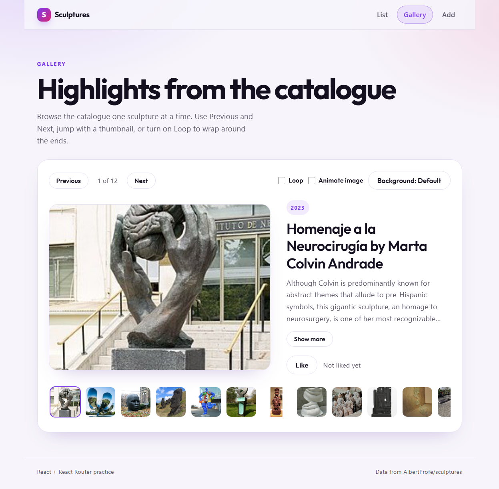
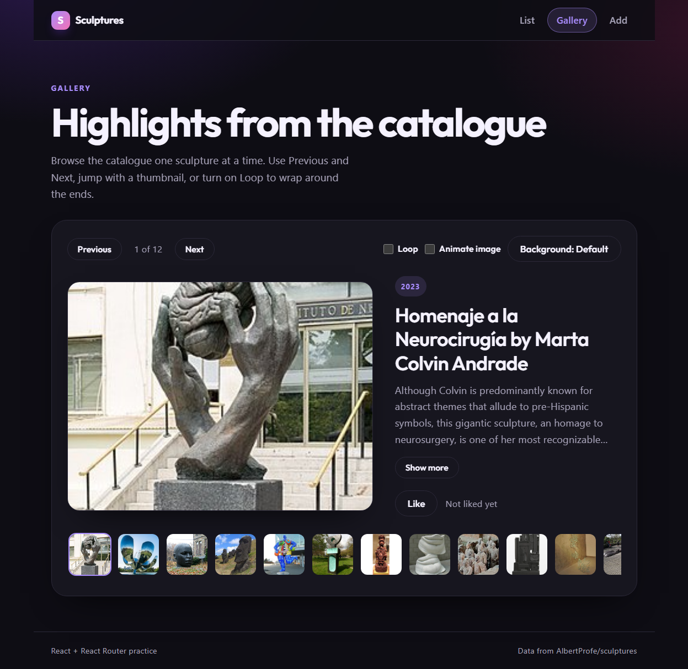
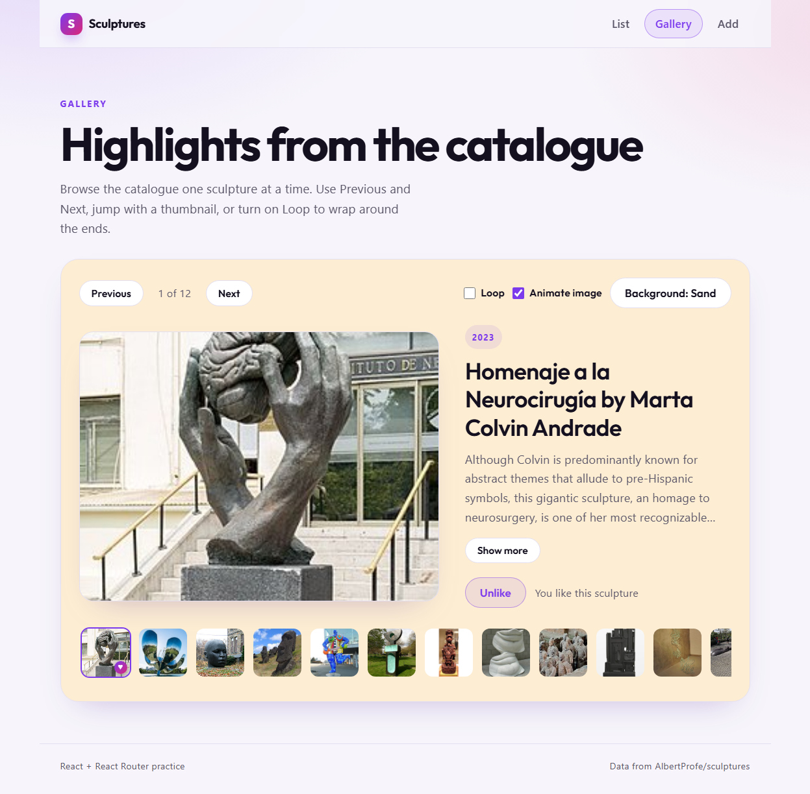
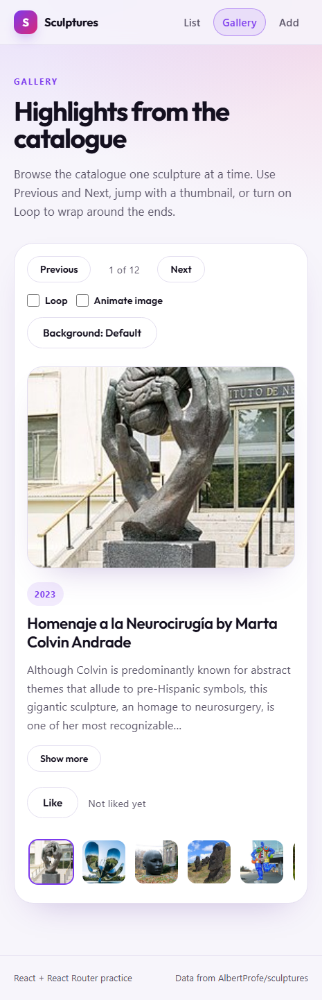

# Anexo 3 — Galería con las diez ideas

## Qué añade este anexo

El archivo [`exercise.md`](../exercise.md) propone diez mejoras para una galería de esculturas.
Este anexo las incorpora a `sculptures-app` en una ruta nueva, `/gallery`, sin duplicar el estado
del catálogo: la galería consume las mismas esculturas que el CRUD.

- Ruta `/gallery` y enlace **Gallery** en la barra superior.
- Componente reutilizable `SculpturesGallery`, con `sculptures` y `caption` como props.
- Estado local para el índice, los likes, Loop, el fondo, la animación y la descripción expandida.

La galería muestra siempre el catálogo completo. El filtro y la paginación del listado viven en la
URL de `/` y no se mezclan con esta vista.

## Estructura

| Archivo | Papel |
|---|---|
| `src/pages/SculptureGalleryPage.jsx` | Lee el catálogo del `Outlet` y lo pasa al componente |
| `src/components/SculpturesGallery.jsx` | Galería: índice, controles y presentación |

Separé la página del componente por dos motivos:

- La página resuelve la integración con React Router (`useOutletContext`).
- El componente recibe las esculturas por props, así que se puede reutilizar o probar sin router,
  y el `caption` es un prop real, no un texto fijo escondido en la página.

```jsx
export default function SculptureGalleryPage() {
  const { sculptures } = useOutletContext()

  return (
    <SculpturesGallery
      sculptures={sculptures}
      caption="Highlights from the catalogue"
    />
  )
}
```

```jsx
export default function SculpturesGallery({
  sculptures,
  caption = 'Sculptures Gallery',
}) {
  // ...
}
```

La ruta usa el valor pasado (`"Highlights from the catalogue"`). El valor por defecto sigue
disponible para cualquier uso futuro que omita el prop, y es el que documenta el propio
componente.

## Las diez ideas

| # | Idea | Implementación |
|---|---|---|
| 1 | Previous | `goPrevious()`; con Loop apagado se deshabilita en el primero |
| 2 | Next deshabilitado en el último | `disabled={!loop && isLast}` |
| 3 | Miniaturas | Una por escultura, con `aria-current` y salto directo al índice |
| 4 | Like por escultura | Objeto `likes` indexado por `id`, botón Like/Unlike y mensaje |
| 5 | Año | Se lee de la escultura que llega por props y se muestra en una píldora |
| 6 | `caption` | Prop con valor por defecto y valor pasado desde la ruta |
| 7 | Wrap-around | Checkbox **Loop**: Next vuelve al primero y Previous al último |
| 8 | Fondo | `BACKGROUNDS` cicla Default → Sand → Sky → Mint → Lilac |
| 9 | Animación | Checkbox que añade `gallery-image--animated` |
| 10 | Show more/less | Límite de 180 caracteres con estado `expandedId` |

## El conflicto entre la idea 2 y la idea 7

La idea 2 pide **desactivar** Next en el último elemento. La idea 7 pide **dar la vuelta** al
primero. Aplicar las dos a la vez es imposible con un solo comportamiento, así que no elegí una y
descarté la otra: expuse las dos mediante un control.

```jsx
function goNext() {
  if (isLast) {
    if (loop) setIndex(0)
    return
  }
  setIndex(safeIndex + 1)
}

function goPrevious() {
  if (isFirst) {
    if (loop) setIndex(sculptures.length - 1)
    return
  }
  setIndex(safeIndex - 1)
}
```

Resultado:

| Loop | En el primero | En el último |
|---|---|---|
| Apagado | Previous deshabilitado | Next deshabilitado |
| Encendido | Previous salta al último | Next salta al primero |

El botón muestra el estado real (`disabled`) y el checkbox explica por qué cambia. Es el mismo
criterio que se usó en la galería del proyecto `sculptures`.

## Decisiones

- **Estado local, no global.** El índice, los likes o el fondo son estado de la vista, no del
  catálogo. Solo las esculturas viven en `useSculptures`; la galería las recibe por props.
- **Índice acotado.** `safeIndex = Math.min(index, sculptures.length - 1)` evita que un borrado
  deje la galería apuntando fuera del array. Si la lista queda vacía, se muestra un estado vacío
  con enlace para crear una escultura.
- **Likes por `id`.** No por posición: al cambiar de escultura cada una conserva su estado. La
  miniatura de una escultura con like muestra un corazón, y su `aria-label` añade “(liked)”.
- **Los likes no se persisten.** Son estado de interfaz. Guardarlos en `localStorage` exigiría
  versionar otra clave y decidir qué hacer al borrar o restaurar el catálogo; queda como mejora
  opcional.
- **Un `expandedId`, no un booleano.** Al pasar a otra escultura la descripción vuelve a la versión
  corta sin necesidad de un `useEffect` que resetee el estado.
- **Fondo con clases, no estilos en línea.** Cada tono es una clase con `color-mix` sobre
  `--surface`, así el modo oscuro se adapta solo y el cambio se anima con una transición.
- **Animación con `key`.** La imagen lleva `key={sculpture.id}` para que el navegador la remonte y
  la animación se reproduzca al cambiar de escultura. Con `prefers-reduced-motion` se desactiva.
- **Miniaturas en una tira con scroll horizontal.** En escritorio caben las doce; en móvil no se
  comprime la imagen principal y la tira sigue siendo accesible.
- **La galería no aplica el filtro del listado.** El ejercicio pide navegar por “all sculptures”.
  Mezclar `?q=` con el índice de la galería haría que un enlace compartido cambiara de significado.
- **Navegación con `NavLink`.** “Gallery” se marca como activa igual que “List” y “Add”.

## Verificación

`npm run lint` y `npm run build` pasan.

Con Chrome headless comprobé las diez ideas, la integración con el CRUD y los estados límite:

```text
ruta /gallery, caption pasado por props y nav activa: true
12 miniaturas, contador 1 of 12 y miniatura 1 activa: true
Previous desactivado y Next activo al inicio: true
nombre, artista y año visibles: true
Next avanza y Previous retrocede: true
miniatura 6 salta al índice 6: true
en el último, Next desactivado sin Loop: true
Loop activado habilita Next: true
Next envuelve al primero y Previous al último: true
al desactivar Loop vuelve a deshabilitar Next: true
Like activa texto, botón y aria-pressed: true
la miniatura marca el like y la siguiente no lo hereda: true
al volver, el like se conserva; Unlike lo desactiva: true
el fondo cicla a Sand y aplica su clase: true
el checkbox activa la animación: true
Show more alarga, Show less vuelve a truncar: true
la galería refleja un borrado hecho en el listado: true
el filtro por año y la paginación siguen funcionando: true
la galería vacía muestra su estado vacío: true
```

## Capturas

| Modo claro | Modo oscuro |
|---|---|
|  |  |

Con fondo Sand, like activo y animación marcada:



En 480 px la galería pasa a una columna y las miniaturas se desplazan en horizontal:



## Fuentes

- [`exercise.md`](../exercise.md), el enunciado de las diez ideas.
- `useState`: https://react.dev/reference/react/useState
- Renderizar listas y `key`: https://react.dev/learn/rendering-lists
- Renderizado condicional: https://react.dev/learn/conditional-rendering
- `prefers-reduced-motion`: https://developer.mozilla.org/en-US/docs/Web/CSS/@media/prefers-reduced-motion
- `color-mix()`: https://developer.mozilla.org/en-US/docs/Web/CSS/color_value/color-mix
