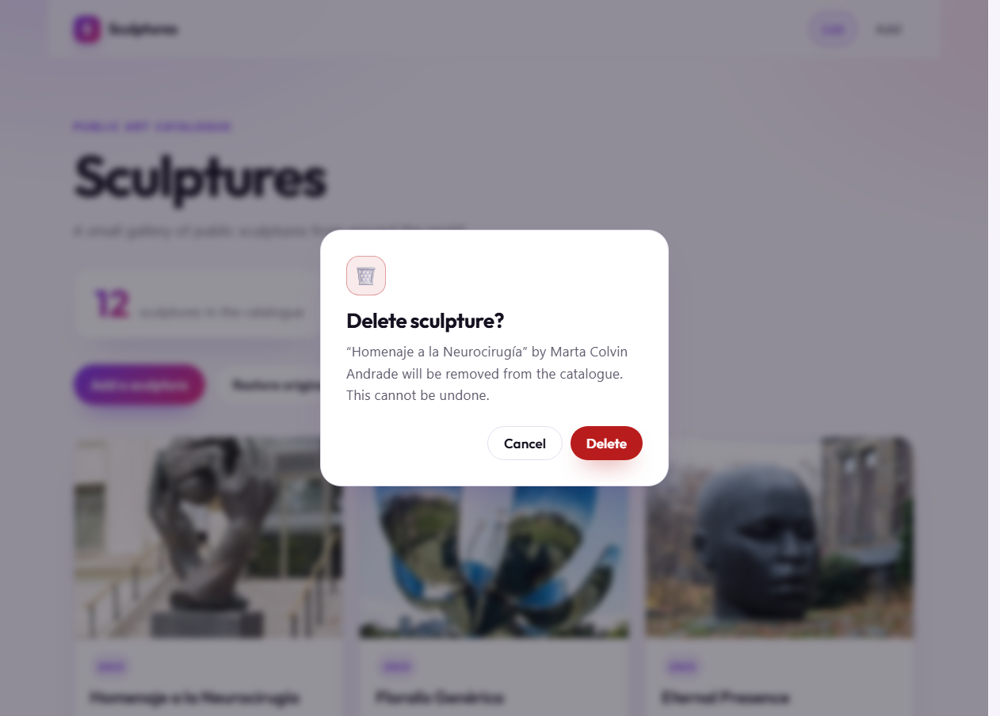
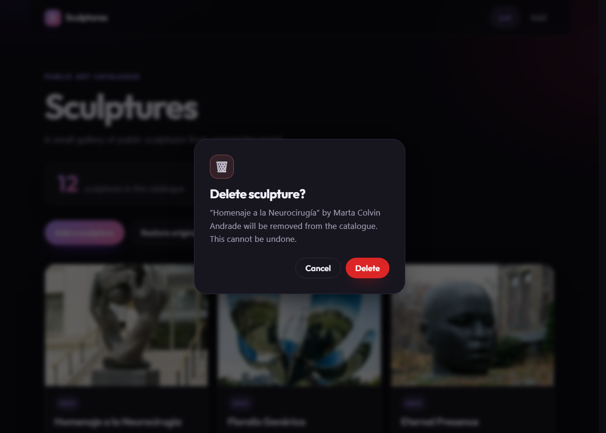

# Bonus 1 — Confirmar el borrado con un modal

## Qué pedía el bonus

El enunciado proponía confirmar antes de borrar con `window.confirm()`, como extra a la parte 7.
La pregunta que surgió después fue si esa confirmación podía ser una ventana modal acorde con
la estética de la aplicación.

Sí: en lugar del diálogo gris del navegador, usé el elemento nativo `<dialog>` y lo vestí con
las mismas variables de tema que el resto de la interfaz.

## Punto de partida

El botón Delete ya borraba directamente. La parte 7 había dejado el borrado inmutable y el
color de peligro, así que la lógica no necesitaba cambios: solo había que interponer una
confirmación entre el clic y `deleteSculpture(id)`.

## Por qué `<dialog>` y no `window.confirm()`

`window.confirm()` tiene tres problemas para esta práctica:

- No se puede estilizar: el navegador decide el aspecto.
- Bloquea el hilo principal mientras está abierto.
- Su texto y sus botones cambian según el navegador y el idioma del sistema.

Además, el enunciado lo planteaba como bonus, no como obligación. Un modal propio encaja mejor
con una aplicación que ya tiene tarjetas, formulario y una paleta definida.

## Por qué el `<dialog>` nativo

Un modal casero con `<div>` y `position: fixed` obliga a implementar a mano el fondo, el foco,
Escape y el bloqueo del resto de la página. El `<dialog>` con `showModal()` ya trae:

- el elemento en la capa superior (*top layer*), por encima de todo;
- el pseudo-elemento `::backdrop` para oscurecer el fondo;
- el cierre con Escape;
- el resto de la página inerte mientras el modal está abierto;
- la devolución del foco al elemento que lo abrió, cuando se cierra.

No añadí ninguna dependencia. MDN documenta la API en:

- https://developer.mozilla.org/en-US/docs/Web/API/HTMLDialogElement
- https://developer.mozilla.org/en-US/docs/Web/API/HTMLDialogElement/showModal
- https://developer.mozilla.org/en-US/docs/Web/CSS/::backdrop

## Implementación

En `SculptureListPage` hay un único `<dialog>` al final de la página y un estado con la
escultura pendiente:

```jsx
const dialogRef = useRef(null)
const [sculptureToDelete, setSculptureToDelete] = useState(null)
```

El botón Delete ya no borra: guarda la escultura.

```jsx
<button
  className="button-ghost button-danger"
  type="button"
  onClick={() => setSculptureToDelete(sculpture)}
  aria-label={`Delete ${sculpture.name}`}
>
  Delete
</button>
```

Un efecto abre o cierra el diálogo según ese estado:

```jsx
useEffect(() => {
  const dialog = dialogRef.current
  if (!dialog) return

  if (sculptureToDelete) {
    if (!dialog.open) dialog.showModal()
    dialog.querySelector('[data-autofocus]')?.focus()
  } else if (dialog.open) {
    dialog.close()
  }
}, [sculptureToDelete])
```

El contenido solo se dibuja cuando hay una escultura pendiente:

```jsx
<dialog
  ref={dialogRef}
  className="confirm-dialog"
  aria-labelledby="delete-dialog-title"
  aria-describedby="delete-dialog-description"
  onClose={() => setSculptureToDelete(null)}
  onKeyDown={keepFocusInside}
>
  {sculptureToDelete && (
    <div className="confirm-card">
      <span className="confirm-icon" aria-hidden="true">🗑️</span>
      <h2 className="confirm-title" id="delete-dialog-title">
        Delete sculpture?
      </h2>
      <p className="confirm-text" id="delete-dialog-description">
        “{sculptureToDelete.name}” by {sculptureToDelete.artist} will be removed
        from the catalogue. This cannot be undone.
      </p>
      <div className="confirm-actions">
        <button className="button-ghost" type="button" data-autofocus
          onClick={() => setSculptureToDelete(null)}>
          Cancel
        </button>
        <button className="button-danger-solid" type="button" onClick={confirmDelete}>
          Delete
        </button>
      </div>
    </div>
  )}
</dialog>
```

Y la confirmación ejecuta el borrado que ya existía:

```jsx
function confirmDelete() {
  if (!sculptureToDelete) return
  deleteSculpture(sculptureToDelete.id)
  setSculptureToDelete(null)
}
```

## Decisiones

- **Un solo diálogo, no uno por tarjeta.** Doce `<dialog>` ocultos serían doce nodos y doce
  `refs` para usar uno cada vez. Con un único diálogo, el estado decide qué escultura se está
  confirmando.
- **Abrir en un efecto, no en el `onClick`.** Si llamara a `showModal()` antes de que React
  pinte el contenido, el diálogo se abriría vacío. El efecto se ejecuta después del render, con
  el nombre y el artista ya en el DOM.
- **`if (!dialog.open)` antes de `showModal()`.** En desarrollo, `StrictMode` puede ejecutar los
  efectos dos veces. Llamar a `showModal()` sobre un diálogo ya abierto lanza una excepción
  `InvalidStateError`.
- **Foco inicial en Cancel.** Es la opción segura: si alguien pulsa Enter sin mirar, no borra.
  No usé `autoFocus` de React porque el contenido se monta mientras el diálogo todavía está
  cerrado; lo marqué con `data-autofocus` y lo enfoqué después de `showModal()`.
- **Escape y `close` limpian el estado.** Así no queda una escultura “pendiente” invisible que
  reaparezca al abrir el modal para otra.
- **El clic en el fondo no confirma ni cierra.** En un borrado prefiero que la decisión sea
  explícita: Cancel o Escape para salir, Delete para confirmar. Tampoco cierra al hacer clic
  fuera, para que un clic accidental no descarte la confirmación.
- **Ciclo de foco con Tab.** El `<dialog>` nativo hace inerte el fondo, pero en Chrome el
  tabulador puede pasar a la interfaz del navegador. Añadí un `onKeyDown` que, al llegar al
  último botón, vuelve al primero, y al revés con `Shift+Tab`. Es la pauta del patrón *Modal
  Dialog* de ARIA APG:
  https://www.w3.org/WAI/ARIA/apg/patterns/dialog-modal/
- **Botones con `type="button"`.** Aunque ahora no hay un formulario alrededor, un `<button>`
  sin tipo dentro de un `<form>` se comportaría como botón de envío.
- **El borrado sigue siendo inmediato al confirmar.** El modal no añade estado intermedio ni
  optimistic UI: llama al mismo `deleteSculpture` de siempre.

## Fallos que encontré

### El fondo se seguía moviendo con la rueda

Con el modal abierto, la página de detrás se podía desplazar con la rueda del ratón. El
`<dialog>` vuelve inerte el contenido, pero el documento seguía haciendo scroll. Lo comprobé
con Chrome: `window.scrollY` pasaba de `0` a `600`.

La solución fue bloquear el scroll mientras el diálogo está abierto, sin tocar JavaScript:

```css
html:has(.confirm-dialog[open]) {
  overflow: hidden;
}
```

Añadí también `scrollbar-gutter: stable` al `html` para que, al desaparecer la barra de scroll,
el contenido no dé un salto horizontal.

### El foco se escapaba con Tab

Sin el ciclo manual, la secuencia era `Cancel → Delete → fuera del diálogo`. El fondo está
inerte, así que no era un fallo de seguridad, pero sí menos cómodo. Con `keepFocusInside` la
secuencia queda `Cancel → Delete → Cancel → …` y `Shift+Tab` hace lo mismo al revés.

La función no intenta adivinar todos los elementos enfocables posibles: recorre botones,
enlaces, campos y elementos con `tabindex`, que es lo que puede aparecer si el modal se
reutiliza en el futuro.

### El diálogo heredaba estilos del navegador

Un `<dialog>` sin estilos trae márgenes, borde, fondo y un ancho máximo propios. Los reseteé en
`.confirm-dialog` (`padding: 0`, `border: 0`, `background: transparent`) y puse el aspecto real
en `.confirm-card`, igual que las tarjetas y el formulario.

## Estética

Todo sale de variables que ya existían, más tres nuevas para el botón sólido:

- `--danger-solid`, `--danger-solid-hover` y `--danger-contrast` en `index.css`, con valores
  distintos para modo claro y oscuro.
- `.confirm-card` reutiliza `--surface`, `--border`, `--shadow-soft` y el radio grande de las
  tarjetas.
- `.confirm-icon` usa `--danger-bg` y `--danger-border`.
- `.button-danger-solid` es la única acción roja llena de la aplicación; el Delete de las
  tarjetas sigue siendo contorno para no competir con “Add a sculpture”.
- El fondo usa `rgba(20, 16, 31, 0.45)` con `backdrop-filter: blur(4px)` en claro y
  `rgba(0, 0, 0, 0.62)` en oscuro.
- La entrada del modal es una animación suave de `opacity` y `scale(0.97) → 1`. En
  `prefers-reduced-motion: reduce` se desactiva.

El modo oscuro sigue siendo automático, por `prefers-color-scheme`, sin interruptor en la
interfaz.

Así se ve el modal en modo claro:



Y así en modo oscuro:



## Accesibilidad

- El diálogo toma su nombre del `<h2>` con `aria-labelledby` y su descripción del párrafo con
  `aria-describedby`.
- El texto incluye el nombre y el artista, no solo un “¿seguro?”.
- El foco empieza en Cancel y no se va de la página con Tab.
- Escape cierra sin borrar.
- El icono es decorativo (`aria-hidden="true"`), porque el texto ya explica la acción.
- El fondo queda inerte gracias al modo modal nativo.
- Los botones conservan el `outline` de foco visible.

## Verificación

`npm run lint` y `npm run build` pasan.

Probé el modal con Chrome headless y el protocolo de DevTools, pulsando y escribiendo como lo
haría una persona:

```text
inicio: 12 tarjetas y dialogo cerrado: true
abrir: dialogo modal abierto: true
abrir: muestra el nombre y el artista correctos: true
abrir: el foco empieza en Cancel: true
abrir: el fondo esta oscurecido: rgba(20, 16, 31, 0.45)
cancelar: cierra y no borra: true
escape: cierra y no borra: true
clic en el fondo: no confirma ni cierra: true
confirmar: cierra, borra una y actualiza el contador: true
confirmar: desaparece la escultura elegida: true
reabrir: muestra la nueva escultura pendiente: true
segundo cancelar: siguen 11: true
```

Y una segunda pasada para el foco y el scroll:

```text
foco tras 6 Tabs: Cancel -> Delete -> Cancel -> Delete -> Cancel -> Delete
el foco nunca sale del dialogo: true
Shift+Tab sigue dentro: true
scroll antes/después de la rueda: 0 / 0
```

También comprobé que, al cerrar con Cancel o con Escape, el foco vuelve al botón Delete de la
tarjeta que abrió el diálogo, no se queda perdido en el `body`.

También revisé capturas en modo claro, modo oscuro y ancho estrecho (504 px): el modal cabe, los
botones no se solapan y el contraste se mantiene.

Los scripts de prueba eran temporales y los borré antes de preparar el commit.

## Lo que dejo pendiente

- **Reutilizar el modal para “Restore original data”**: la restauración sigue siendo inmediata.
  El mismo componente podría recibir otro título, otro texto y otro icono.
- **Confirmar también desde el detalle**, si algún día se añade allí el borrado.
- **Cerrar al hacer clic en el fondo**: lo dejé fuera a propósito, pero es una decisión de
  producto que se puede cambiar.

## Fuentes

- `<dialog>`: https://developer.mozilla.org/en-US/docs/Web/API/HTMLDialogElement
- `showModal()`: https://developer.mozilla.org/en-US/docs/Web/API/HTMLDialogElement/showModal
- `::backdrop`: https://developer.mozilla.org/en-US/docs/Web/CSS/::backdrop
- Patrón Modal Dialog de ARIA APG: https://www.w3.org/WAI/ARIA/apg/patterns/dialog-modal/
- `:has()`: https://developer.mozilla.org/en-US/docs/Web/CSS/:has
- `scrollbar-gutter`: https://developer.mozilla.org/en-US/docs/Web/CSS/scrollbar-gutter
- `prefers-reduced-motion`: https://developer.mozilla.org/en-US/docs/Web/CSS/@media/prefers-reduced-motion
