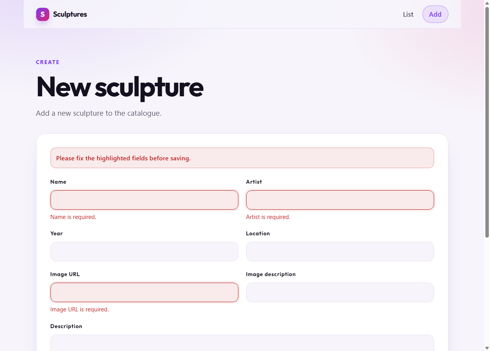

# Bonus 2 — Validación del formulario

## Qué pedía el bonus

Exigir `name`, `artist` y `url` antes de guardar, y mostrar los errores en línea, junto al campo
que los provoca.

El formulario ya era controlado desde la parte 6, pero no comprobaba nada: se podía enviar vacío
y se guardaba una escultura con el nombre en blanco.

## Punto de partida

`SculptureFormPage` guardaba los valores en `form` y los enviaba tal cual, recortando espacios con
`trim()`. El atributo `type="url"` solo aportaba la validación nativa del navegador, que muestra
un globo emergente y no deja personalizar el mensaje ni el estilo.

## Implementación

Añadí un estado de errores y una función de validación pura:

```jsx
const [errors, setErrors] = useState({})

function validate(values) {
  const nextErrors = {}

  if (!values.name.trim()) nextErrors.name = 'Name is required.'
  if (!values.artist.trim()) nextErrors.artist = 'Artist is required.'

  const url = values.url.trim()
  if (!url) {
    nextErrors.url = 'Image URL is required.'
  } else {
    try {
      const parsed = new URL(url)
      if (parsed.protocol !== 'http:' && parsed.protocol !== 'https:') {
        nextErrors.url = 'Use an http:// or https:// URL.'
      }
    } catch {
      nextErrors.url = 'Enter a valid URL, for example https://example.com/image.jpg.'
    }
  }

  const year = values.year.trim()
  if (year && (!/^\d{1,4}$/.test(year) || Number(year) > 3000)) {
    nextErrors.year = 'Enter a whole year between 0 and 3000.'
  }

  return nextErrors
}
```

En `handleSubmit` valido primero y, si hay errores, no guardo:

```jsx
const nextErrors = validate(values)

if (Object.keys(nextErrors).length > 0) {
  setErrors(nextErrors)

  const firstError = FIELD_ORDER.find((field) => nextErrors[field])
  event.currentTarget.elements.namedItem(firstError)?.focus()
  return
}
```

Cada campo muestra su mensaje y se asocia con él:

```jsx
<input
  id="name"
  name="name"
  value={form.name}
  onChange={handleChange}
  required
  aria-invalid={errors.name ? 'true' : undefined}
  aria-describedby={errors.name ? 'name-error' : undefined}
/>
{errors.name && (
  <p className="form-error" id="name-error">
    {errors.name}
  </p>
)}
```

Y el formulario lleva `noValidate` para que el navegador no bloquee el envío antes de que mis
mensajes puedan aparecer.

## Decisiones

- **Validar al enviar, limpiar al escribir.** No quería que un formulario recién abierto
  apareciera lleno de rojo. Los errores salen al intentar guardar; en cuanto el usuario corrige
  un campo, su error desaparece.
- **`trim()` antes de validar.** Un nombre con solo espacios no cuenta como nombre.
- **URL con `new URL()`.** Comprueba que la cadena se puede interpretar como URL y limita los
  protocolos a `http:` y `https:`. Un `ftp://` o un `javascript:` no sirven para una etiqueta
  ``.
- **El año es opcional.** El enunciado solo obliga a nombre, artista y URL. Si se escribe, exijo
  un entero entre 0 y 3000. Si se deja vacío, se guarda como cadena vacía y la tarjeta y el
  detalle simplemente no muestran la etiqueta del año.
- **`noValidate` y validación propia.** La validación nativa no permite mensajes en línea
  consistentes ni enfocar el primer error con mi propio orden. Los atributos `required`,
  `type="url"`, `min`, `max` y `step` se quedan como información semántica para el navegador y
  los lectores de pantalla.
- **Foco en el primer campo inválido.** El orden es `name → artist → url → year`. Si hay varios
  errores, el usuario no tiene que buscarlos.
- **Resumen con `role="alert"`.** Además de los mensajes individuales, aparece un aviso arriba
  del formulario. Así la validación se anuncia sin depender de que el lector de pantalla recorra
  cada campo.
- **Sin librerías.** Para tres campos obligatorios y una URL, una función de veinte líneas es
  más fácil de entender que añadir una dependencia.

## Fallos que encontré

### La validación nativa tapaba mis mensajes

El primer intento mantuvo el formulario sin `noValidate`. Al pulsar el botón con los campos
vacíos, el navegador mostraba su propio globo sobre el campo `name` y no ejecutaba mi
`handleSubmit`, así que los errores en línea nunca llegaban a verse. La solución fue añadir
`noValidate` y encargarme yo de toda la validación.

### El CSS nuevo no aparecía

Los errores se veían, pero en gris y sin el borde rojo. El atributo `aria-invalid` estaba bien y
la regla `.form-error` existía en `App.css`.

Lo comprobé con Chrome: `getComputedStyle` devolvía el color heredado, y `document.styleSheets`
no encontraba la regla. El servidor de desarrollo seguía sirviendo una versión antigua del CSS:
el primer cambio de estilos se había aplicado por HMR, pero el segundo, hecho casi a la vez, no.
Reiniciar Vite solucionó el problema y los estilos calculados pasaron a ser los correctos.

No era un fallo del código, pero me llevó un rato. Lo apunto porque conviene desconfiar del HMR
cuando un cambio pequeño “no hace nada” y el archivo sí lo contiene.

## Verificación

`npm run lint` y `npm run build` pasan.

Con Chrome headless probé el formulario vacío, una URL inválida, un protocolo no permitido, el
alta correcta y la edición:

```text
validación: tres errores al enviar vacío: true
validación: mensajes: [
  'Name is required.',
  'Artist is required.',
  'Image URL is required.'
]
validación: foco en el primer campo inválido: true
validación: aria-invalid en Name: true
validación: sigue en el formulario: true
validación: el error de Name desaparece al escribir: true
validación: URL inválida: true
validación: protocolo no permitido: true
validación: con datos válidos crea y navega: true
editar: Name vacío muestra error: true
editar: guarda y vuelve al listado: true
```

Así se ve un formulario con los tres errores:



## Fuentes

- Formularios controlados en React: https://react.dev/reference/react-dom/components/input
- `noValidate`: https://developer.mozilla.org/en-US/docs/Web/API/HTMLFormElement/noValidate
- Constraint validation: https://developer.mozilla.org/en-US/docs/Web/HTML/Constraint_validation
- `aria-invalid`: https://developer.mozilla.org/en-US/docs/Web/Accessibility/ARIA/Reference/Attributes/aria-invalid
- `aria-describedby`: https://developer.mozilla.org/en-US/docs/Web/Accessibility/ARIA/Reference/Attributes/aria-describedby
- `URL`: https://developer.mozilla.org/en-US/docs/Web/API/URL
- HMR de Vite: https://vite.dev/guide/features#hot-module-replacement
