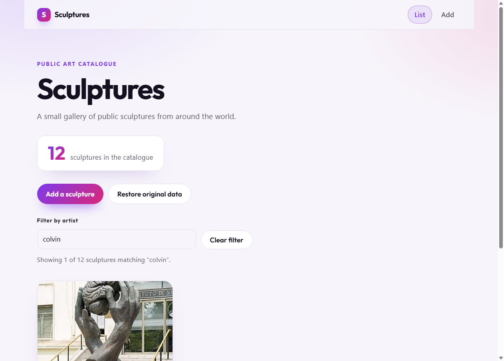

# Bonus 3 — Filtro por artista con `useSearchParams`

## Qué pedía el bonus

Poder filtrar el listado por artista y que el filtro viviera en la URL, de forma que
`/?artist=hepworth` mostrara solo las esculturas de Barbara Hepworth.

## Punto de partida

El listado dibujaba las doce esculturas sin ningún control. La única fuente de estado era el
array `sculptures` que llegaba por el contexto del `Outlet`.

## Implementación

El filtro no vive en un `useState`: se lee de la URL con `useSearchParams`.

```jsx
const [searchParams, setSearchParams] = useSearchParams()

const artistFilter = searchParams.get('artist') ?? ''
const trimmedFilter = artistFilter.trim()
const hasFilter = trimmedFilter.length > 0

const visibleSculptures = hasFilter
  ? sculptures.filter((sculpture) =>
      normalize(sculpture.artist).includes(normalize(trimmedFilter)),
    )
  : sculptures
```

`normalize` pasa todo a minúsculas, separa los acentos y los elimina. Así `jose garcia`
encuentra a `José García` y `HEPWORTH` encuentra a `Barbara Hepworth`.

```jsx
function normalize(value) {
  return value
    .toLocaleLowerCase()
    .normalize('NFD')
    .replace(/[\u0300-\u036f]/g, '')
}
```

El input es controlado por la URL y cada cambio actualiza el parámetro:

```jsx
function updateArtistFilter(value) {
  const next = new URLSearchParams(searchParams)

  if (value.trim()) {
    next.set('artist', value)
  } else {
    next.delete('artist')
  }

  setSearchParams(next, { replace: true })
}
```

La interfaz muestra el resumen y un estado vacío cuando no hay coincidencias:

```jsx
<p className="filter-summary" role="status">
  Showing {visibleSculptures.length} of {sculptures.length}{' '}
  {sculptures.length === 1 ? 'sculpture' : 'sculptures'} matching “{trimmedFilter}”.
</p>
```

## Decisiones

- **La URL es la única fuente de verdad.** Si guardara también el texto en un `useState`, el
  input y la URL podrían desincronizarse al entrar con un enlace directo o al usar atrás/adelante.
  Con `useSearchParams` no hay dos copias del mismo dato.
- **`replace: true`.** Cada tecla no debe crear una entrada nueva en el historial. Si no, el
  botón Atrás tendría que deshacer el filtro letra a letra.
- **Copiar los parámetros existentes.** `new URLSearchParams(searchParams)` conserva otros
  parámetros que pueda haber en el futuro; solo modifico `artist`.
- **Filtro insensible a mayúsculas y acentos.** Escribir `generica` debe encontrar `Genérica`.
  Es una pequeña función, pero cambia mucho la sensación de calidad.
- **Solo por artista.** El enunciado lo pide así. Filtrar también por nombre sería otra decisión
  de producto; no la mezclo en el mismo parámetro.
- **El contador grande sigue mostrando el total.** El resumen debajo del filtro dice cuántos se
  están viendo. Así “12 sculptures in the catalogue” sigue siendo cierto aunque el filtro muestre
  una sola tarjeta, y no parece que se hayan borrado las demás.
- **Borrar o restaurar no limpia el filtro.** El parámetro se mantiene y el listado se recalcula.
  Si ya no queda ninguna coincidencia, aparece el estado vacío con “Clear filter”.
- **Volver del formulario lleva al listado sin filtro.** Crear o editar navega a `/`. Es una
  limitación consciente: preservar el filtro exigiría pasarlo por la URL del formulario o usar
  `navigate(-1)`, y no era el objetivo de este bonus.

## Fallos que evité

Mi primera idea fue guardar el texto en un `useState` y, además, escribirlo en la URL. Eso
funciona hasta que alguien abre `/?artist=hepworth` directamente: el estado arranca vacío y el
input no coincide con lo que se está filtrando. Habría que sincronizar estado y URL con un
`useEffect`, con el riesgo de bucles y parpadeos.

Lo dejé en una sola dirección: URL → input → URL. Menos código y menos estados imposibles.

## Verificación

`npm run lint` y `npm run build` pasan.

Probé el filtro escribiendo como una persona, abriendo enlaces directos y borrando con el filtro
activo:

```text
filtro: URL y una tarjeta: true
filtro: resumen: Showing 1 of 12 sculptures matching “colvin”.
filtro: insensible a mayúsculas: true
filtro: estado sin resultados: true
filtro: limpiar desde el estado vacío: true
filtro: enlace directo con ?artist=hepworth: true
filtro: insensible a acentos con la nueva artista: true
borrar con filtro: queda 1 y se mantiene la URL: true
borrar con filtro: resumen actualizado: Showing 1 of 11 sculptures matching “unknown”.
```

Así se ve el listado con un filtro activo:



## Fuentes

- `useSearchParams` de React Router: https://reactrouter.com/api/hooks/useSearchParams
- `URLSearchParams`: https://developer.mozilla.org/en-US/docs/Web/API/URLSearchParams
- `String.prototype.normalize`: https://developer.mozilla.org/en-US/docs/Web/JavaScript/Reference/Global_Objects/String/normalize
- `String.prototype.toLocaleLowerCase`: https://developer.mozilla.org/en-US/docs/Web/JavaScript/Reference/Global_Objects/String/toLocaleLowerCase
