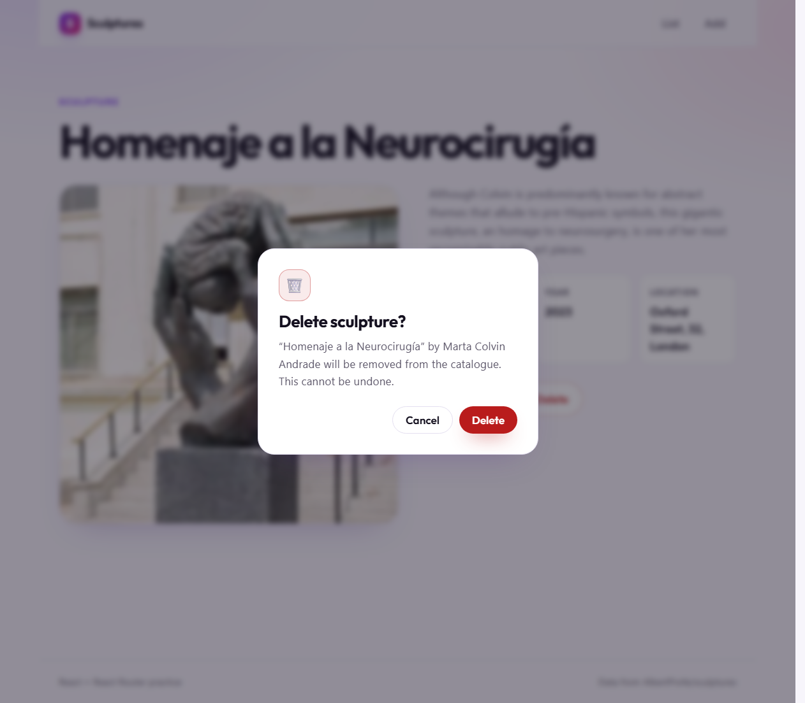
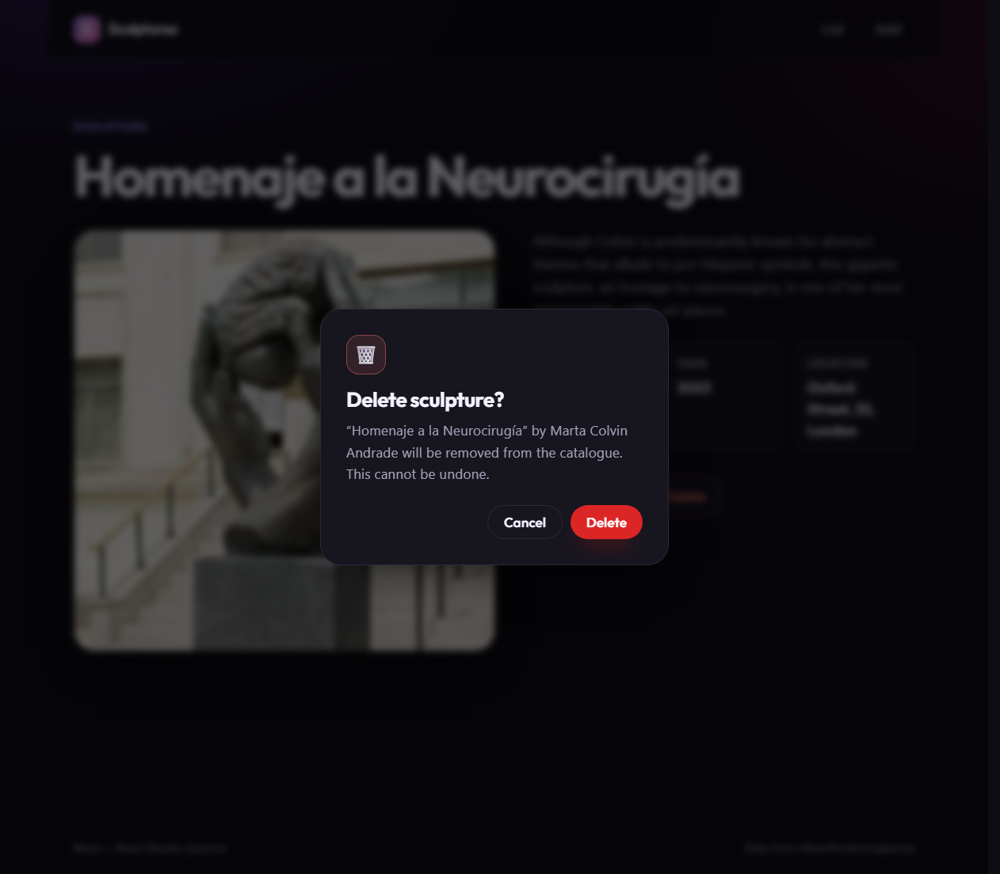

# Bonus 5 — Borrar desde el detalle

## Qué pedía el enunciado

La parte 7 pedía el borrado desde el listado y dejaba como bonus hacerlo también desde el detalle,
con `navigate('/')` después. El [Bonus 1](bonus-01-confirmacion-borrado.md) ya había extraído la
confirmación a `ConfirmDialog`, así que este bonus solo tenía que reutilizarla.

## Punto de partida

`SculptureDetailPage` era de solo lectura: mostraba imagen, descripción, artista, año y localización
—cuando existe—, con un único enlace “Back to list”. El contexto del `Outlet` ya exponía
`deleteSculpture` y el diálogo era reutilizable, pero la página no los usaba.

## Implementación

### 1. Leer el borrado y preparar la navegación

```jsx
const { sculptures, deleteSculpture } = useOutletContext()
const navigate = useNavigate()
const [confirmOpen, setConfirmOpen] = useState(false)
```

`confirmOpen` no guarda la escultura: en el detalle solo hay una posible, así que un booleano
basta. Es la diferencia con la lista, donde `pendingAction` distingue entre borrar y restaurar y
recuerda qué tarjeta se eligió.

### 2. Añadir el botón a las acciones

```jsx
<button
  className="button-ghost button-danger"
  type="button"
  onClick={() => setConfirmOpen(true)}
  aria-label={`Delete ${sculpture.name}`}
>
  Delete
</button>
```

Reutiliza las clases de la parte 7, así que el color de peligro, el hover y el foco son los mismos
que en el listado sin añadir CSS nuevo.

### 3. Confirmar, borrar y volver al catálogo

```jsx
function handleDelete() {
  deleteSculpture(sculpture.id)
  setConfirmOpen(false)
  navigate('/')
}
```

`deleteSculpture` sigue siendo el mismo handler inmutable del hook: filtra el array por id y
devuelve uno nuevo. La página no toca el estado directamente.

### 4. Reutilizar el diálogo

```jsx
<ConfirmDialog
  open={confirmOpen}
  icon="🗑️"
  title="Delete sculpture?"
  description={`“${sculpture.name}” by ${sculpture.artist} will be removed from the catalogue. This cannot be undone.`}
  confirmLabel="Delete"
  onConfirm={handleDelete}
  onCancel={() => setConfirmOpen(false)}
/>
```

El texto incluye nombre y artista, como en el listado. El resto —`showModal()`, foco inicial en
Cancel, Escape, ciclo de Tab y bloqueo del scroll— lo aporta el componente compartido.

## Decisiones

- **Reutilizar, no duplicar.** El comportamiento delicado del modal ya estaba resuelto y probado
  en el Bonus 1. Duplicarlo en el detalle habría creado dos versiones que podrían divergir.
- **Un booleano en lugar de la escultura pendiente.** En el detalle no hay ambigüedad: la
  escultura es la de la URL. La lista necesita más estado porque puede confirmar dos acciones
  distintas sobre cualquiera de las tarjetas.
- **Volver siempre a `/`.** Es lo que pide el enunciado. Además, borrar cambia el número de
  resultados: conservar `q`, `field`, `view` o `page` podría dejar al usuario en una página que ya
  no existe.
- **El botón es secundario.** `.button-danger` mantiene el contorno rojo en lugar del rojo lleno
  del modal; la acción destructiva de verdad es la que se confirma dentro del diálogo.
- **`aria-label` con el nombre.** Aunque en esta página solo hay un botón “Delete”, el nombre
  completo lo hace autoexplicativo si el detalle se reutiliza o si se navega con un lector de
  pantalla.
- **El diálogo se cierra antes de navegar.** Evita que el `onClose` del `<dialog>` se ejecute
  mientras la página se está desmontando.
- **Sin cambios en el hook ni en el router.** La ruta `sculptures/:id` ya existía y el contexto ya
  llevaba `deleteSculpture`; el bonus era solo una página que no lo consumía.

## Qué pasa con el filtro y la paginación

Al navegar a `/` se pierden `field`, `q`, `view` y `page`. Es intencionado y coherente con el
enunciado, pero conviene saberlo: si alguien estaba viendo la página 2 de un filtro y borra desde
el detalle, vuelve al catálogo completo. Para conservar el contexto habría que volver con
`navigate(-1)` o reconstruir la URL de origen, y comprobar que la página sigue siendo válida
después del borrado.

## Verificación

`npm run lint` y `npm run build` pasan.

Probé el flujo completo con Chrome headless contra el servidor de desarrollo:

```text
inicio: 12 tarjetas y contador 12: true
detalle abierto: true
abre diálogo: true
texto con nombre y artista: true
foco inicial en Cancel: true
Cancel no borra: true
confirma y vuelve a /: true
quedan 11 tarjetas: true
la escultura desaparece: true
persistido en localStorage: true
el borrado de la lista sigue funcionando: true
restaurar pide confirmación y devuelve 12: true
```

En la misma pasada comprobé que el Anexo 2 no se había roto: los cuatro campos siguen ahí, `2024`
filtra por año, la paginación conserva `field` y `q`, y el enlace heredado `?artist=colvin` sigue
funcionando.

## Capturas

| Modo claro | Modo oscuro |
|---|---|
|  |  |

La disposición se revisó también en un ancho de 480 px: el botón Delete baja junto a “Back to
list” y el modal cabe sin solapamientos.

## Fuentes

- `useNavigate`: https://reactrouter.com/api/hooks/useNavigate
- `<dialog>` y `showModal()`: https://developer.mozilla.org/en-US/docs/Web/API/HTMLDialogElement
- `aria-label`: https://developer.mozilla.org/en-US/docs/Web/Accessibility/ARIA/Reference/Attributes/aria-label
- Actualizar arrays en estado: https://react.dev/learn/updating-arrays-in-state
