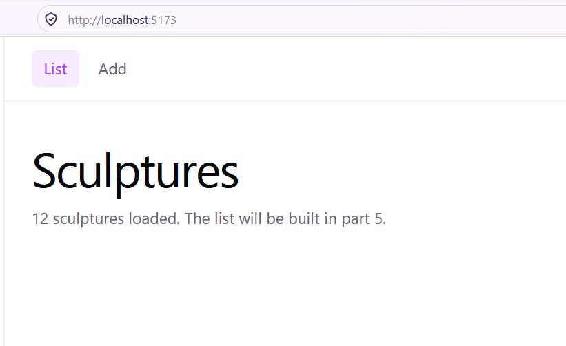
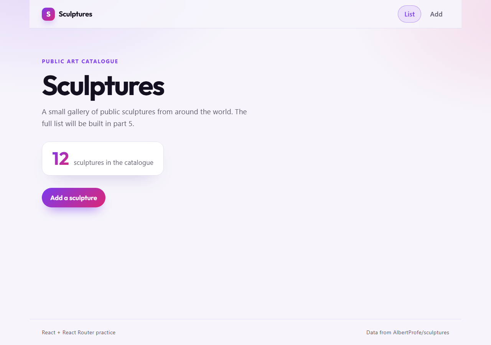
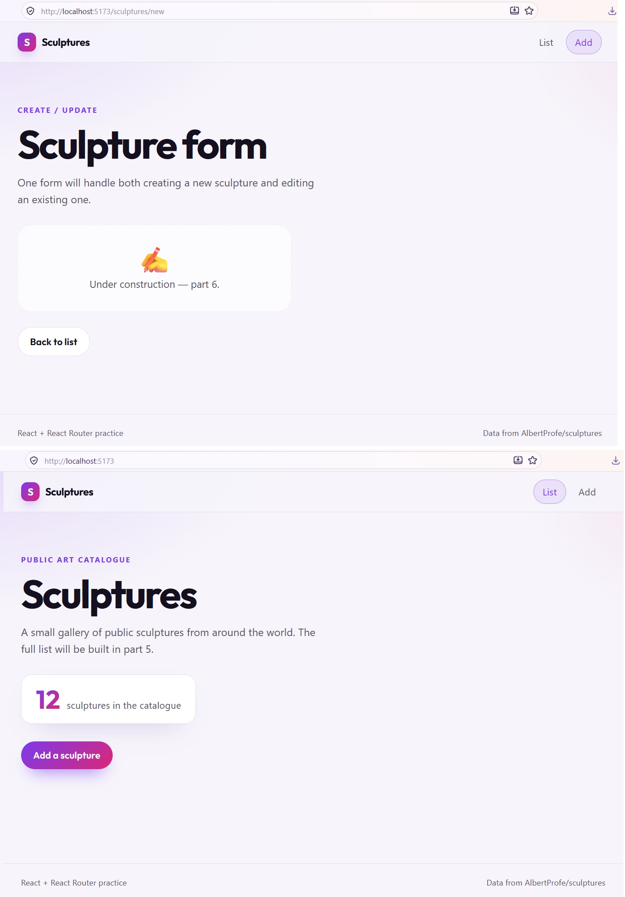
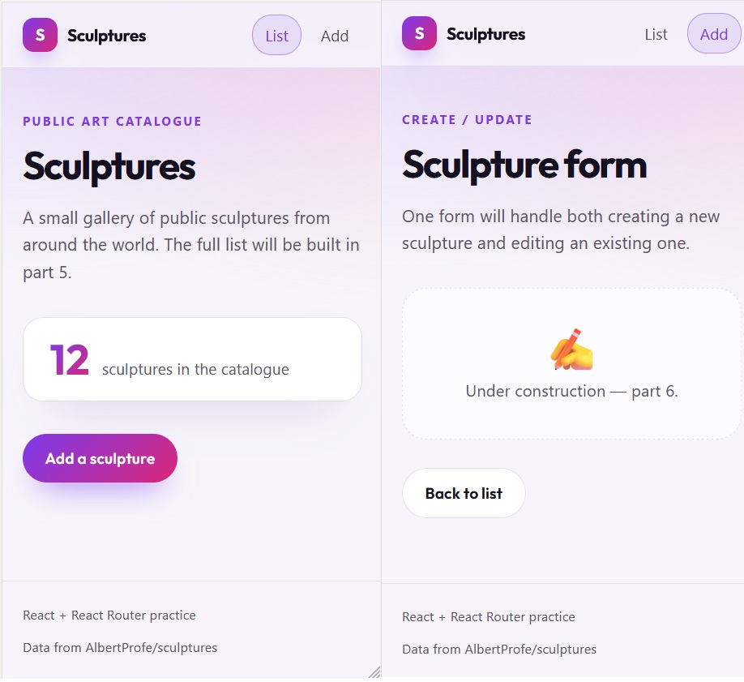

# Parte 4 — Rutas y barra de navegación

## Qué pedía esta parte

Montar el router en `App.jsx` y crear `Layout.jsx` con una barra superior de navegación:

- `BrowserRouter`, `Routes` y `Route` en `App`.
- Rutas anidadas dentro de `Layout`: índice (lista), detalle, crear, editar y 404.
- `NavLink` a la lista y a “Add”.
- Pasar el estado compartido a las páginas con `<Outlet context={...} />`.

## Punto de partida

`App.jsx` seguía siendo la página de bienvenida de Vite. `react-router-dom` ya estaba
instalado desde la parte 1 y el estado con los ids ya estaba en `data.js` desde la parte 2.

## Fallo 1: Vite me peta porque las páginas no existen

Copié el esqueleto del enunciado tal cual. Al arrancar, Vite me suelta:

```
Failed to resolve import "./pages/Layout.jsx" from "src/App.jsx". Does the file exist?
```

Es lógico: el router necesita un `element` para cada `Route` y las páginas son de las partes
5, 6 y 7. No existen todavía.

**Solución:** creo la carpeta `src/pages/` y dejo cascarones mínimos:

- `SculptureListPage.jsx` → solo un título y un texto de “pendiente”.
- `SculptureDetailPage.jsx` → igual.
- `SculptureFormPage.jsx` → igual.
- `NoPage.jsx` → este sí lo hago completo, porque no tiene parte propia: un 404 con enlace
  a la lista.

Podría haber puesto `<div>TODO</div>` directamente en `App.jsx` y cambiar las rutas después,
pero entonces tendría que reescribir `App.jsx` en la parte 5. Prefiero cascarones ahora y
rellenarlos sin tocar las rutas.

## Fallo 2: `Layout` se queda sin las esculturas

Dejé `<Route path="/" element={<Layout />} />` como en el enunciado. En la página de lista
puse `const { sculptures } = useOutletContext()` y al hacer `sculptures.length` me petó:
`sculptures` era `undefined`.

En la parte 3 ya había comprobado que `<Outlet sculptures={...} />` no reenvía props. El
problema ahora era otro: **`Layout` no recibía nada porque la ruta lo montaba sin props**.

Buscando “pass props to Outlet react router” encontré esta respuesta de Stack Overflow, que
lo explica claro: *“The Outlet doesn't take any props, nor will it pass anything as props on
to what it renders”*.

- https://stackoverflow.com/questions/70027979/passing-props-to-outlet-when-nesting-routes-in-react-router-v6

**Solución:** pasarle las props a `Layout` desde el `element` de la ruta:

```jsx
<Route
  path="/"
  element={
    <Layout
      sculptures={sculptures}
      addSculpture={addSculpture}
      updateSculpture={updateSculpture}
      deleteSculpture={deleteSculpture}
    />
  }
>
```

Y dentro de `Layout`, repartirlas por el `Outlet`:

```jsx
<Outlet context={{ sculptures, addSculpture, updateSculpture, deleteSculpture }} />
```

Esto es lo que recomienda la documentación oficial de `useOutletContext`:

- https://reactrouter.com/api/hooks/useOutletContext
- https://reactrouter.com/api/components/Outlet

## Fallo 3: el enlace “List” siempre está activo

Puse los dos `NavLink` y, al entrar en `/sculptures/3`, “List” seguía marcado como activo.
Claro: `NavLink` a `/` coincide con cualquier ruta que empiece por `/`.

Busqué “react router navlink always active” y salió esta pregunta:

- https://stackoverflow.com/questions/71236890/react-router-dom-v6-navlink-is-always-active

**Solución:** añadir `end` al enlace de la lista:

```jsx
<NavLink to="/" end>List</NavLink>
```

Con `end`, solo se marca activo cuando la ruta es exactamente `/`. Comprobado después en el
HTML: en `/sculptures/new` la clase `active` la lleva “Add”, no “List”.

## Fallo 4 (falso amigo): la clase `active` y las respuestas viejas de Stack Overflow

En varias respuestas de 2021–2022 leí que en React Router v6 había que usar la función de
`className` porque `activeClassName` ya no existía:

```jsx
<NavLink className={({ isActive }) => (isActive ? 'active' : undefined)}>
```

Lo probé y funcionaba, pero luego vi que `NavLink` ya añade la clase `active` por defecto.
Lo comprobé renderizando el componente y el HTML salía así:

```html
<a aria-current="page" class="active" href="/">List</a>
```

En la versión que tenemos (React Router 7) no hace falta la función. Quité el `className`
para no complicar `Layout` y dejé el CSS apuntando a `.topbar a.active`. Me apunto la
lección: muchas respuestas de Stack Overflow son de v6 y no siempre aplican igual en v7.

Documentación oficial de `NavLink`:

- https://reactrouter.com/api/components/NavLink

## Fallo 5: el 404 se comía la barra de navegación

Primero puse la ruta `*` fuera de `Layout`. Al entrar en `/no-existe` aparecía el 404, pero
desaparecía el menú. Tiene sentido: si el 404 no está dentro de la ruta padre, no se renderiza
dentro del `Outlet`.

**Solución:** moverla dentro de `Layout`:

```jsx
<Route path="*" element={<NoPage />} />
```

Ahora el 404 conserva la barra y el enlace “Back to list”.

## Fallo 6: ESLint me marca `setSculptures` sin usar

El esqueleto del enunciado ya traía los TODO de `addSculpture`, `updateSculpture` y
`deleteSculpture`. Si escribo solo:

```jsx
const [sculptures, setSculptures] = useState(sculptureList)
```

ESLint me marca `setSculptures` como variable sin usar (`no-unused-vars`). Como los handlers
ya estaban en el esqueleto de esta parte, los escribí ahora:

```jsx
function addSculpture(sculpture) {
  const newSculpture = { ...sculpture, id: crypto.randomUUID() }
  setSculptures((current) => [...current, newSculpture])
}

function updateSculpture(id, changes) {
  setSculptures((current) =>
    current.map((sculpture) =>
      String(sculpture.id) === String(id)
        ? { ...sculpture, ...changes, id: sculpture.id }
        : sculpture,
    ),
  )
}

function deleteSculpture(id) {
  setSculptures((current) =>
    current.filter((sculpture) => String(sculpture.id) !== String(id)),
  )
}
```

Decisiones:

- Uso las funciones actualizadoras (`setSculptures(current => ...)`) porque el estado nuevo
  depende del anterior. Es lo que recomienda la documentación de `useState`:
  https://react.dev/reference/react/useState#updating-state-based-on-the-previous-state
- Comparo los ids con `String()` porque los datos semilla tienen ids numéricos y las
  esculturas nuevas usarán `crypto.randomUUID()` (texto), como decidí en la parte 2.
- `updateSculpture` conserva el `id` original aunque los cambios traigan otro.
- `addSculpture` genera el id con `crypto.randomUUID()`.

Estos handlers todavía no los usa ninguna página: se probarán en las partes 5, 6 y 7. Aquí
solo dejo el estado y el contexto preparados.

## Dudas que comprobé

- **¿`sculptures/:id` se come `sculptures/new`?** Probé el caso con `:id` declarado antes y
  `/sculptures/new` renderiza el formulario, no el detalle. Las rutas estáticas tienen
  prioridad, así que no hace falta reordenar. Aun así, el orden del archivo sigue el del
  enunciado.
- **¿`index` o `path="/"` para la ruta de la lista?** Probé las dos y las dos renderizan la
  lista. Me quedo con `index` porque es lo que se usa para la ruta por defecto de un layout.
- **¿Un solo `BrowserRouter`?** Sí, en `App.jsx` como dice el enunciado. `main.jsx` no se
  toca.

## Estilos

Sustituí el contenido de `App.css` (el del template de Vite) por estilos propios:

- `.topbar`: barra superior con `display: flex`, borde inferior y `position: sticky`.
- `.topbar a.active`: color y fondo del enlace activo.
- `main`: ocupa el espacio restante, con padding y texto alineado a la izquierda.

Borré las clases del template (`.hero`, `.counter`, `#next-steps`, etc.) porque `App.jsx` ya
no las usa. Los archivos de `src/assets/` siguen ahí; no los he borrado por si hicieran falta,
aunque ahora mismo no se usan.

## Verificación

- `npm run lint` → sin errores.
- `npm run build` → compila.
- Prueba temporal con `MemoryRouter` y los componentes reales, renderizados a HTML:

| Ruta               | Resultado                                  |
| ------------------ | ------------------------------------------ |
| `/`                | lista, “List” activo                       |
| `/sculptures/3`    | detalle, ningún enlace activo              |
| `/sculptures/new`  | formulario, “Add” activo                   |
| `/no-existe`       | 404 dentro de `Layout`, con barra visible  |

El archivo de prueba lo borré después; no forma parte del proyecto.

## Qué no he hecho todavía

- La lista real, el detalle y el formulario (partes 5 y 6).
- El borrado desde la interfaz (parte 7).
- Cambios en `data.js`, `main.jsx` o la configuración de Vite. En `index.html` solo se
  añadieron la fuente y el título, y el favicon también es nuevo (ver el extra de estética).

## Extra: lavado de cara (después de la parte 4)

Con la parte 4 funcionando, abrí la aplicación y me pareció sosísima: todo blanco, la
tipografía del sistema y una página casi vacía. Un estudiante tiene derecho a perder un rato
en la estética, así que me di el gusto **sin tocar rutas, estado ni handlers**.

Así se veía antes:



Y así después:



También guardé una captura de escritorio y otra de la versión móvil:





### Qué cambié

- **Tipografía**: añadí `Outfit` desde Google Fonts para títulos, marca y botones. El texto
  normal sigue con la fuente del sistema para no cargar más de la cuenta.
  https://fonts.google.com/specimen/Outfit
- **Paleta**: morado y rosa (`#7c3aed` → `#db2777`) con variables CSS, y versión para modo
  oscuro.
- **Fondo**: dos degradados radiales suaves con `background-attachment: fixed`. Lo saqué de
  la documentación de MDN:
  https://developer.mozilla.org/en-US/docs/Web/CSS/gradient/radial-gradient
- **Barra superior**: marca con un cuadrado degradado y la letra “S”, navegación en forma de
  píldoras y fondo semitransparente con `backdrop-filter: blur()`. Para el color mezclado usé
  `color-mix()`:
  https://developer.mozilla.org/en-US/docs/Web/CSS/color_value/color-mix
- **Páginas**: clases reutilizables `.page`, `.eyebrow`, `.page-title`, `.page-lead`,
  `.stat-card`, `.empty-card`, `.button-primary` y `.button-ghost`.
- **Página de lista**: ahora tiene un contador grande de esculturas y un botón para añadir.
- **Detalle, formulario y 404**: en vez de un texto pelado, tienen una tarjeta de “en
  construcción” con un emoji y un botón para volver.
- **Footer**: una línea discreta con la tecnología y la fuente de los datos.
- **Favicon**: sustituí el de Vite por una “S” con el mismo degradado.

### Fallos y ajustes

1. **La barra y el contenido no estaban alineados.** La marca empezaba en `x=112` y el título
   en `x=181`, porque `main` tenía `max-width: 980px` y la barra ocupaba todo el ancho.
   Cambié `main` y `.footer` a `max-width: 1126px` (el mismo de `#root`) y ahora comparten
   margen.
2. **La captura móvil salía recortada.** Pensé que el CSS desbordaba, pero al comprobar
   `innerWidth` con Chrome headless me daba `504` en vez de `390`: es el ancho mínimo que usa
   el navegador en ese modo, no un fallo de la página. Probé a 504 px y la barra, la tarjeta y
   el pie se adaptan bien. No perdí más tiempo intentando emular un móvil de verdad.
3. **Dependencia externa de la fuente.** Si no hay internet, el navegador usa la fuente del
   sistema y la página sigue funcionando. No quise descargar la fuente al proyecto para no
   meter archivos extra.

### Verificación

- `npm run lint` y `npm run build` siguen pasando.
- Hice capturas con Chrome headless de la lista, el formulario, el 404, el modo oscuro y un
  ancho estrecho. Todas se ven correctas y no hay desbordamientos.
- Las capturas son temporales; no se suben al repositorio.

### Para las siguientes partes

La idea es reutilizar esta base en vez de rehacerla:

- **Parte 5**: una rejilla de tarjetas para las esculturas, reutilizando `.stat-card` y los
  botones.
- **Parte 6**: estilos para los campos del formulario.
- **Parte 7**: un botón de borrar con un color de peligro.

Con esto, cada parte nueva puede añadir un poco de cariño visual sin tener que empezar de
cero.
