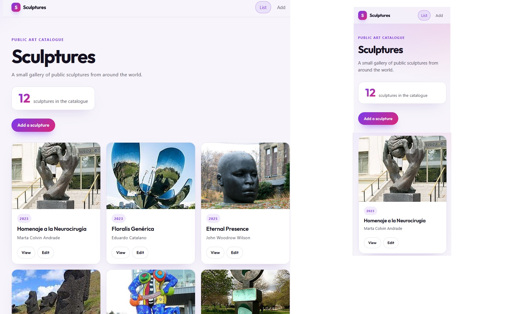

# Parte 5 — Read: listado y detalle

## Qué pedía esta parte

Convertir los dos cascarones de la parte 4 en páginas de lectura de verdad:

- **Listado** (`/`): recorrer el array de esculturas y mostrar imagen, nombre, artista, año y
  enlaces para ver y editar cada una.
- **Detalle** (`/sculptures/:id`): leer el `id` de la URL, buscar la escultura y mostrar todos
  sus datos, con la ubicación solo cuando existe.
- Si el `id` no corresponde a ninguna escultura, mostrar un estado de “no encontrada” sin
  romper la aplicación.

No había que tocar rutas, estado, handlers, `Layout` ni `data.js`: el contexto del `Outlet`
ya traía las esculturas desde la parte 4.

## Punto de partida

`SculptureListPage` solo tenía un contador y un botón de “Add”, y `SculptureDetailPage` era una
tarjeta de “en construcción — part 5”. Ambas ya usaban `useOutletContext()` para leer
`sculptures`, así que el trabajo era sobre todo de renderizado.

## El listado: `map` y tarjetas

Sustituí el contenido de `SculptureListPage` por un `map` sobre `sculptures`. Cada escultura se
pinta como un `<li>` con la imagen, el año, el nombre, el artista y dos enlaces:

```jsx
<ul className="sculpture-grid">
  {sculptures.map((sculpture) => (
    <li className="sculpture-card" key={sculpture.id}>
      <div className="sculpture-media">
        
      </div>

      <div className="sculpture-body">
        <p className="sculpture-year">{sculpture.year}</p>
        <h2 className="sculpture-name">{sculpture.name}</h2>
        <p className="sculpture-artist">{sculpture.artist}</p>

        <div className="sculpture-actions">
          <Link className="button-ghost" to={`/sculptures/${sculpture.id}`}>
            View
          </Link>
          <Link className="button-ghost" to={`/sculptures/${sculpture.id}/edit`}>
            Edit
          </Link>
        </div>
      </div>
    </li>
  ))}
</ul>
```

Detalles que tuve en cuenta:

- **La imagen lleva `alt`.** El array de `data.js` ya trae un `alt` descriptivo por escultura
  y me pareció un desperdicio no usarlo. Además, si imgur bloquea una imagen, al menos queda
  el texto alternativo.
- **`loading="lazy"`.** Son doce imágenes externas y no todas se ven al cargar la página; así
  el navegador solo descarga las que se acercan a la ventana. Lo leí en MDN:
  https://developer.mozilla.org/en-US/docs/Web/HTML/Reference/Elements/img#loading
- **Los enlaces apuntan a rutas que ya existen** desde la parte 4. El formulario de `Edit`
  sigue siendo un cascarón hasta la parte 6, pero la navegación no da error.

### La importancia de `key` (esto lo quería destacar)

La documentación de React lo trata en **Rendering Lists**, y me quedo con la idea de que la
`key` no es un adorno para que ESLint se calle: es lo que permite a React saber qué elemento
del array es cuál entre renders.

- https://react.dev/learn/rendering-lists

Lo que dice la documentación, resumido:

- Hay que poner una `key` a cada elemento que se genera con `map`.
- Las `key` deben ser **únicas entre hermanos**, no en toda la aplicación.
- Lo correcto es usar un identificador estable, como el `id` de la base de datos. En este caso,
  `key={sculpture.id}`.
- **No conviene usar el índice del array** (`key={index}`): si se inserta, borra o reordena,
  los índices cambian y React puede reutilizar el nodo equivocado, con lo que se mezclan
  estados o se repintan cosas que no tocaban.
- La `key` no se pasa como prop al componente; React la reserva para sí mismo.

En esta práctica se nota poco porque el listado solo lee, pero en la parte 7, cuando se borre
una escultura, el índice de las siguientes cambiaría. Con `id` eso no pasa.

### Fallo 1: me comí la `key` y React me avisó

Mi primera versión puso la `key` en el `<div>` interior, no en el `<li>` que devuelve el
`map`. En la consola del navegador salió el aviso clásico:

```
Warning: Each child in a list should have a unique "key" prop.
```

React necesita la `key` en el elemento que se repite, es decir, en el primer nodo que devuelve
el `map`. La moví al `<li>` y el aviso desapareció. Lo comprobé también con el HTML generado:
cada `<li>` lleva su escultura correspondiente.

## El detalle: `useParams` y la búsqueda

`SculptureDetailPage` ahora lee el parámetro de la ruta y busca la escultura en el array:

```jsx
const { id } = useParams()
const { sculptures } = useOutletContext()

const sculpture = sculptures.find((item) => String(item.id) === String(id))
```

### Fallo 2: el detalle siempre decía “not found”

Al principio escribí la comparación “de libro”:

```jsx
const sculpture = sculptures.find((item) => item.id === id)
```

Y `/sculptures/1` me mostraba “Sculpture not found”. El motivo es que `useParams()` devuelve
**siempre texto**: `{ id: "1" }`. Los ids de `data.js` son números, y `1 === "1"` es `false`.
No era un fallo de la búsqueda, era un fallo de tipos.

**Solución:** comparar ambos lados como texto con `String()`:

```jsx
const sculpture = sculptures.find((item) => String(item.id) === String(id))
```

Es la misma decisión que ya había tomado en los handlers de la parte 4, para que convivan los
ids numéricos de las esculturas semilla y los `crypto.randomUUID()` de las nuevas.

### Fallo 3: el `return` temprano se comía un hook

Para el caso “no encontrada” puse un `if (!sculpture) return ...` justo después de declarar
`id`, y ESLint me marcó:

```
React Hook "useOutletContext" is called conditionally
```

Era un aviso de `react-hooks/rules-of-hooks`, y con razón: si la primera vez no hay escultura
y se sale antes de llamar al hook, en el siguiente render el orden de hooks cambia. Moví el
`useOutletContext()` **arriba, junto al `useParams()`**, y dejé el `return` temprano después
de las dos llamadas. Los hooks van siempre en el mismo orden, sin condiciones.

Documentación de las reglas de los hooks:

- https://react.dev/reference/rules/rules-of-hooks

### `location` solo si existe

Solo la escultura 1 tiene `location` en `data.js`; el resto no. En vez de imprimir un hueco o
un “undefined”, la pinto con una condición:

```jsx
{sculpture.location && (
  <div>
    <dt>Location</dt>
    <dd>{sculpture.location}</dd>
  </div>
)}
```

Si la propiedad no existe, React no renderiza nada. Comprobé que `/sculptures/2` no muestra
“Location” y que `/sculptures/1` sí muestra “Oxford Street, 32, London”.

Usé una lista de definiciones (`<dl>` con `<dt>`/`<dd>`) porque son datos con nombre y valor,
no párrafos. Es lo que recomienda MDN para este tipo de contenido:

- https://developer.mozilla.org/en-US/docs/Web/HTML/Reference/Elements/dl

### El estado “no encontrada”

Si no hay coincidencia, la página devuelve un bloque con el mismo aspecto que el resto:

```jsx
if (!sculpture) {
  return (
    <section className="page">
      <p className="eyebrow">Not found</p>
      <h1 className="page-title">Sculpture not found</h1>
      <p className="page-lead">There is no sculpture with id {id} in the catalogue.</p>

      <div className="page-actions">
        <Link className="button-ghost" to="/">Back to list</Link>
      </div>
    </section>
  )
}
```

Así `/sculptures/999` no rompe y el usuario tiene una salida. Este mismo estado servirá en la
parte 7 si se borra una escultura desde su detalle: al desaparecer del array, la página ya sabe
qué hacer.

## ¿Y el botón de borrar?

El TODO de la parte 5 lo menciona, pero el borrado tiene su propia parte, la 7. Decidí **no
adelantarlo**:

- Esta parte queda como lectura pura y se entiende mejor.
- `deleteSculpture` ya existe desde la parte 4, así que la parte 7 no se queda vacía: podrá
  añadir el botón, la confirmación y el estado de peligro en la interfaz.
- El detalle ya contempla el caso de que la escultura no exista, así que no habrá que rehacerlo.

## Estilos: reutilizar lo que hay, preparar lo que falta

Como acordamos, en esta parte **no escribí CSS nuevo**. Usé las clases que ya venían de la
parte 4:

| Clase | Uso |
| --- | --- |
| `.page` | Contenedor y animación de entrada |
| `.eyebrow` | Antetítulo de cada página |
| `.page-title` | Título |
| `.page-lead` | Introducción y descripción |
| `.stat-card` | Contador de esculturas |
| `.page-actions` | Contenedor de botones |
| `.button-primary` | Enlace para añadir |
| `.button-ghost` | View, Edit y Back to list |
| `.empty-card` | Estado vacío heredado de la parte 4 |

Además dejé puestos los nombres de clase que usaré en el pase de estilos, sin reglas todavía:

- Listado: `.sculpture-grid`, `.sculpture-card`, `.sculpture-media`, `.sculpture-body`,
  `.sculpture-year`, `.sculpture-name`, `.sculpture-artist`, `.sculpture-actions`.
- Detalle: `.detail-layout`, `.detail-media`, `.detail-body`, `.detail-meta`.

Así el pase visual se hace solo en `App.css` y no hay que volver a tocar el JSX. De momento el
listado se ve funcional pero sencillo: una lista sin tarjeta, imágenes de 80 px y botones con
el estilo de la parte 4.

## Verificación

Para no depender de mirar la pantalla a ojo, monté un script temporal con Vite en modo SSR,
`MemoryRouter` y `renderToString`. Rendericé `/`, `/sculptures/1`, `/sculptures/2` y
`/sculptures/999`, y comprobé el HTML:

```
tarjetas: 12
enlaces view/edit: true true
detalle 1 con location: true
detalle 2 sin location: true
detalle 999 not found: true
```

También pasaron:

```bash
npm run lint
npm run build
```

El script era temporal, así que lo borré antes de commitear. La revisión visual (modo oscuro y
ancho estrecho) la dejé para el pase de estilos, que es donde toca.

## Pase de estilos (commit aparte)

Con la funcionalidad cerrada y el commit hecho, me permití el rato de estética. Todo el cambio
está en `App.css` y en un pequeño ajuste de JSX del detalle; no toqué rutas, estado ni handlers.

### Listado

- **`.sculpture-grid`**: rejilla responsive con
  `grid-template-columns: repeat(auto-fill, minmax(260px, 1fr))`. Mi primer intento fue fijar
  tres columnas (`repeat(3, 1fr)`), pero al estrechar la ventana las tarjetas se aplastaban y
  el texto se partía mal. Con `auto-fill` y un mínimo de 260 px, el navegador decide solo
  cuántas caben y pasa a una columna en pantallas estrechas.
- **`.sculpture-card`**: fondo `--surface`, borde, esquinas redondeadas y `--shadow-soft`. Al
  pasar el ratón se eleva 4 px y cambia el borde al color de acento.
- **`.sculpture-media`**: relación de aspecto `4 / 3` y `object-fit: cover`, para que todas las
  miniaturas tengan la misma altura aunque las fotos originales sean distintas. Con
  `overflow: hidden` y un `scale(1.04)` al hacer hover, la imagen se acerca sin mover la
  tarjeta. `aspect-ratio` está documentado en MDN:
  https://developer.mozilla.org/en-US/docs/Web/CSS/aspect-ratio
- **`.sculpture-year`**: el año como distintivo en forma de píldora con `--accent-bg` y
  `--accent`. Así destaca sin competir con el nombre.
- **`.sculpture-actions`**: `margin-top: auto` empuja los botones al fondo de la tarjeta, de
  forma que todas las filas quedan alineadas aunque un nombre ocupe dos líneas.
- Los botones View/Edit se quedan pequeños (`padding: 8px 16px`) para que la tarjeta no parezca
  un panel de administración.

### Detalle

- **`.detail-layout`**: dos columnas con `minmax(0, 1.05fr)` y `minmax(0, 0.95fr)`. El
  `minmax(0, ...)` evita que un texto largo ensanche la columna y rompa la rejilla; es un truco
  que ya había visto en el CSS del template de Vite.
- **`.detail-media`**: la imagen va en una tarjeta con borde y sombra, redondeada, para que no
  quede pegada al texto.
- **`.detail-meta`**: los datos en una rejilla `auto-fit` con un bloque por campo; la etiqueta
  (`<dt>`) en mayúsculas pequeñas y el valor (`<dd>`) con la tipografía de títulos.
- **Ajuste de composición**: en la primera versión el botón “Back to list” estaba fuera del
  `detail-layout`, al final de la página. En escritorio aparecía debajo de la imagen, lejos de
  los metadatos, y parecía pertenecer a la foto. Lo moví dentro de `.detail-body`, después de
  la lista de datos, con la clase `.detail-actions` para darle margen superior.

### Estado “no encontrada”

En vez de dejar el texto suelto, reutilicé `.empty-card` y `.empty-icon` de la parte 4, con el
emoji 🗿 y el botón centrado (`.empty-card .page-actions`). No hizo falta inventar un
componente nuevo.

### Responsive y modo oscuro

- Añadí un punto de ruptura a `760px`: la rejilla del listado y las dos columnas del detalle
  pasan a una sola columna.
- Revisé el resultado a 504 px, que es el ancho mínimo que me da Chrome headless (el mismo
  detalle que apunté en la parte 4).
- En modo oscuro todo funciona porque los colores salen de las variables de `index.css`. El
  único valor fijo es la sombra del hover, que ya estaba pensada para el fondo claro; en oscuro
  se ve discreta y no la cambié.

### Verificación

- `npm run lint` y `npm run build` pasan.
- Capturas con Chrome headless:
  - listado a 1280 px, modo claro y modo oscuro;
  - detalle de la escultura 1 (con `location`) y de la 2 (sin `location`);
  - `/sculptures/999` con el estado “not found”;
  - listado y detalle a 504 px.
- Las capturas de verificación son temporales; las de la apariencia final sí las guardo en
  `docs/`.

Así queda el listado en escritorio y en ancho estrecho:



## Microanimaciones: entrada escalonada de las tarjetas

Como último toque, añadí una animación de entrada para que las tarjetas no aparezcan de golpe.
La idea es sencilla: cada tarjeta empieza un poco desplazada hacia abajo y transparente, y va
apareciendo con un retraso ligeramente mayor que la anterior.

### Cómo lo hice

En el `map` añadí el índice y lo pasé a una variable CSS:

```jsx
{sculptures.map((sculpture, index) => (
  <li
    className="sculpture-card"
    key={sculpture.id}
    style={{ '--card-index': String(index) }}
  >
```

No es lógica nueva: el índice solo alimenta el CSS. El estilo de la tarjeta queda así:

```css
.sculpture-card {
  animation: card-in 0.55s ease backwards;
  animation-delay: min(calc(var(--card-index, 0) * 55ms), 440ms);
}

@keyframes card-in {
  from {
    opacity: 0;
    transform: translateY(14px);
  }
  to {
    opacity: 1;
    transform: translateY(0);
  }
}
```

Decisiones:

- **55 ms entre tarjetas** es suficiente para que se note la cascada sin que la última tarde
  una eternidad.
- **`min(..., 440ms)`** pone un tope al retraso. Si en la parte 6 se añaden muchas esculturas,
  las últimas no se quedarían esperando medio minuto. `min()` con valores de tiempo está
  documentado en MDN:
  https://developer.mozilla.org/en-US/docs/Web/CSS/min
- La `key` estable de la parte 5 ayuda aquí: al añadir una escultura, las tarjetas existentes
  conservan su nodo y no repiten la animación; solo la nueva entra con su retraso.
- Añadí `animation: none` dentro de `prefers-reduced-motion: reduce`, porque hay usuarios que
  configuran el sistema para evitar animaciones:
  https://developer.mozilla.org/en-US/docs/Web/CSS/@media/prefers-reduced-motion

### Fallo: `both` me bloqueaba el hover

Mi primera versión usó `animation-fill-mode: both`, que es lo que se suele ver en los ejemplos.
El problema es que `both` mantiene aplicado el último fotograma **para siempre**, incluido el
`transform`. Como las animaciones tienen prioridad sobre las declaraciones normales en la
cascada, el `transform: translateY(-4px)` del hover no se aplicaba una vez terminada la entrada.

**Solución:** usar `backwards` en vez de `both`. Con `backwards`, el estado inicial se aplica
durante el retraso, pero al terminar la animación el navegador vuelve a los estilos base. Como
el último fotograma ya es `opacity: 1` y `translateY(0)`, no hay salto visible y el hover vuelve
a funcionar.

Información de la propiedad:

- https://developer.mozilla.org/en-US/docs/Web/CSS/animation-fill-mode

### Verificación

- `npm run lint` y `npm run build` pasan.
- Captura a 300 ms: la primera tarjeta está casi entera, la segunda a medio aparecer y la
  tercera apenas se intuye. Captura a 3 s: las doce están visibles y colocadas.
- Probé también con `--force-prefers-reduced-motion`: las tarjetas aparecen completas desde el
  primer momento, sin animación.
- Las capturas de la animación son temporales y no se suben al repositorio.

## Fuentes

- Listas y `key`: https://react.dev/learn/rendering-lists
- Reglas de los hooks: https://react.dev/reference/rules/rules-of-hooks
- `useParams`: https://reactrouter.com/api/hooks/useParams
- `useOutletContext`: https://reactrouter.com/api/hooks/useOutletContext
- `loading` de las imágenes: https://developer.mozilla.org/en-US/docs/Web/HTML/Reference/Elements/img#loading
- Listas de definiciones: https://developer.mozilla.org/en-US/docs/Web/HTML/Reference/Elements/dl
- `aspect-ratio`: https://developer.mozilla.org/en-US/docs/Web/CSS/aspect-ratio
- `min()`: https://developer.mozilla.org/en-US/docs/Web/CSS/min
- Animaciones y `animation-fill-mode`: https://developer.mozilla.org/en-US/docs/Web/CSS/animation-fill-mode
- `prefers-reduced-motion`: https://developer.mozilla.org/en-US/docs/Web/CSS/@media/prefers-reduced-motion
