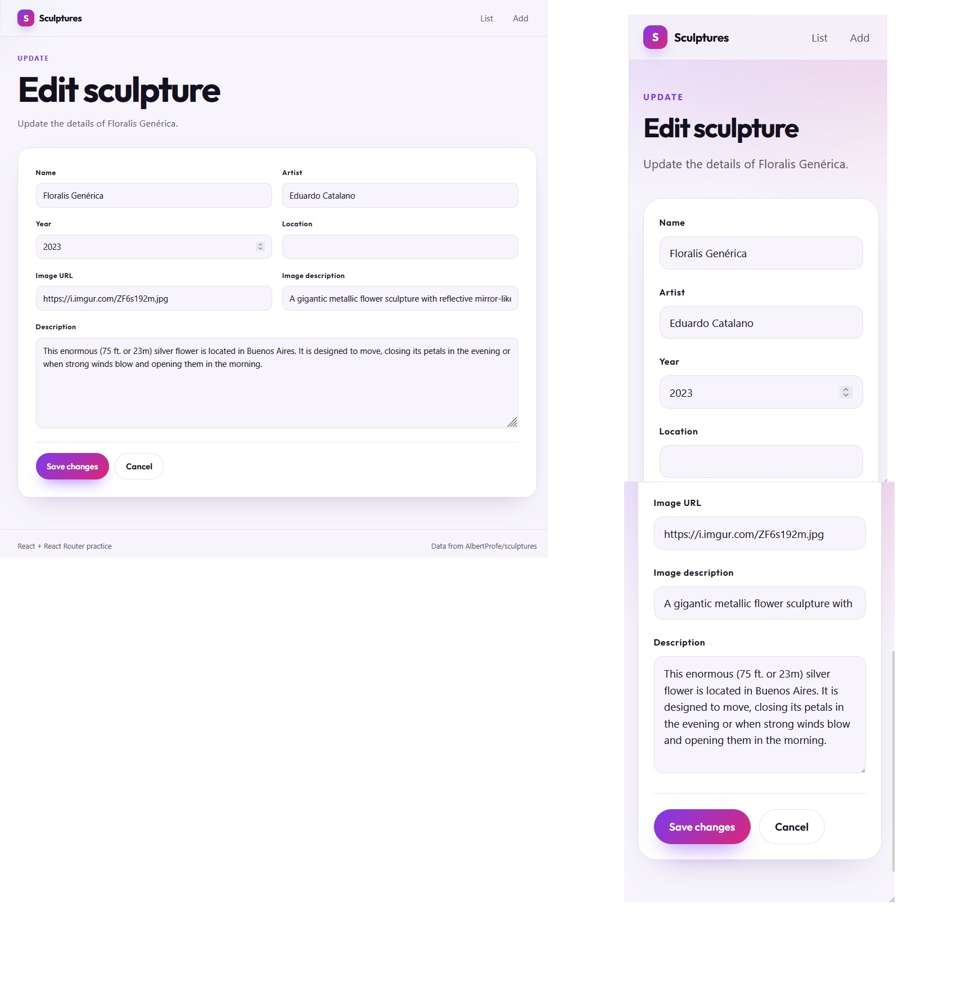

# Parte 6 — Create + Update: un formulario compartido

## Qué pedía esta parte

Usar **un solo formulario** para crear y editar esculturas:

- En `/sculptures/new`, los campos empiezan vacíos y el botón dice “Create sculpture”.
- En `/sculptures/:id/edit`, los campos se rellenan con la escultura existente y el botón dice
  “Save changes”.
- Al enviar, llamar a `addSculpture` o `updateSculpture` según el modo y volver a la lista con
  `navigate("/")`.
- Campos: nombre, artista, año, ubicación, URL de la imagen, descripción de la imagen y
  descripción.

No había que tocar `App.jsx`: los handlers ya estaban desde la parte 4 y el contexto del
`Outlet` los reparte a todas las páginas.

## Punto de partida

`SculptureFormPage` era una tarjeta de “en construcción — part 6”. Las rutas ya existían y
`data.js` ya tenía todos los campos, incluida `location` opcional.

## Un solo componente para los dos modos

La clave es `useParams()`: en `/sculptures/new` devuelve `{}` y en `/sculptures/5/edit`
devuelve `{ id: '5' }`. Por eso puedo decidir el modo con:

```jsx
const isEdit = Boolean(id)
```

El formulario guarda todos los valores como texto, que es lo que devuelven los inputs. El año
se convierte a número al enviar:

```jsx
const [form, setForm] = useState(() =>
  sculpture ? formFromSculpture(sculpture) : emptyForm(),
)

function handleChange(event) {
  const { name, value } = event.target
  setForm((current) => ({ ...current, [name]: value }))
}
```

Uso un único `handleChange` para todos los campos. Cada input lleva `name` igual que su clave
en el objeto de estado, así `[name]: value` actualiza el campo correcto sin escribir siete
funciones casi idénticas.

Al enviar:

```jsx
const sculptureData = {
  name: form.name.trim(),
  artist: form.artist.trim(),
  year: Number(form.year),
  location: form.location.trim(),
  url: form.url.trim(),
  alt: form.alt.trim(),
  description: form.description.trim(),
}

if (isEdit) {
  updateSculpture(id, sculptureData)
} else {
  addSculpture(sculptureData)
}

navigate('/')
```

`navigate("/")` es lo que recomienda el enunciado y lo que ya había apuntado en la parte 3: un
`<Link>` no envía el formulario, solo cambia de página. Documentación:

- https://reactrouter.com/api/hooks/useNavigate

## Fallo 1: el formulario se quedaba con los datos del modo anterior

React Router puede reutilizar el mismo componente al pasar de una ruta a otra si el tipo de
elemento no cambia. En este caso, `/sculptures/new` y `/sculptures/:id/edit` renderizan los dos
`SculptureFormPage`, así que el estado del formulario podía sobrevivir de un modo al otro: iba a
editar y me encontraba los campos vacíos de la creación, o al revés.

La solución es obligar a React a montar un formulario nuevo cuando cambia el id. Para eso uso
una `key`:

```jsx
export default function SculptureFormPage() {
  const { id } = useParams()

  return <SculptureForm key={id ?? 'new'} id={id} />
}
```

`key` no es solo para listas: también sirve para reiniciar el estado de un componente. La
documentación de React lo explica en *Preserving and Resetting State*:

- https://react.dev/learn/preserving-and-resetting-state

El componente interno `SculptureForm` recibe el `id` como prop y ya puede usar `useState` sin
más efectos ni sincronizaciones.

## Fallo 2: el año y los inputs controlados

El primer intento guardó el año como número en el estado:

```jsx
year: sculpture.year
```

Al escribir en el input, `event.target.value` siempre es texto, así que el estado mezclaba
número y texto. Además, si el campo se vaciaba, el valor se convertía en `0` y el input
mostraba un cero que el usuario no había escrito.

**Solución:** guardar el año como texto mientras se edita (`String(sculpture.year)` al
inicializar) y convertirlo con `Number(form.year)` justo antes de guardar. El input queda
controlado de principio a fin y no aparece el aviso de React sobre pasar de un input no
controlado a controlado.

Documentación de inputs controlados:

- https://react.dev/reference/react-dom/components/input#controlling-an-input-with-a-state-variable

## Fallo 3: editar una escultura que no existe

Si se entra en `/sculptures/999/edit`, la búsqueda devuelve `undefined` y el formulario no
tiene de dónde sacar los datos. Reutilicé el estado “not found” de la parte 5, con una tarjeta y
un enlace para volver, en vez de mostrar inputs vacíos que luego fallarían al guardar.

El `return` temprano va **después** de los hooks (`useParams`, `useOutletContext`, `useState`),
para que el orden de hooks sea siempre el mismo. Es la misma lección de la parte 5.

## Campos y clases preparadas para el pase visual

Los siete campos son:

| Campo | Control | Notas |
| --- | --- | --- |
| `name` | `<input type="text">` | — |
| `artist` | `<input type="text">` | — |
| `year` | `<input type="number">` | se guarda como texto hasta el envío |
| `location` | `<input type="text">` | opcional; vacío se guarda como `''` |
| `url` | `<input type="url">` | — |
| `alt` | `<input type="text">` | descripción de la imagen |
| `description` | `<textarea>` | — |

Como en la parte 5, **no añadí CSS nuevo**. Dejé puestas las clases que usaré después:

- `.sculpture-form`
- `.form-grid`
- `.form-field`
- `.form-field-wide`
- `.form-label`
- `.form-input`
- `.form-textarea`
- `.form-actions`

De momento el formulario se ve con los estilos nativos del navegador, que es suficiente para
comprobar que funciona. El pase visual va en un commit aparte.

## Verificación

### Renderizado inicial

Con un script temporal de Vite en modo SSR comprobé el HTML:

```
crear: botón Create sculpture: true
crear: 6 inputs + 1 textarea: 6 1
editar 1: nombre precargado: true
editar 1: año precargado: true
editar 1: localización precargada: true
editar 1: botón Save changes: true
editar 2: localización vacía: true
editar 999: not found: true
```

### Interacción real

Monté Chrome headless y lo controlé con el protocolo de DevTools para rellenar el formulario y
enviarlo como lo haría una persona. Resultados:

```
inicio: 12 tarjetas: true
editar: formulario precargado: true
editar: vuelve a la lista: true
editar: mantiene 12 tarjetas (no duplica): true
editar: muestra el nombre nuevo: true
editar: el detalle mantiene el id y el nombre nuevo: true
crear: vuelve a la lista: true
crear: ahora hay 13 tarjetas: true
crear: aparece la escultura nueva: true
crear: el detalle muestra los datos guardados: true
```

También comprobé que `/sculptures/999/edit` muestra “Sculpture not found”.

Un detalle que me llevé aprendido: al recargar la página con `F5`, el estado vuelve a las doce
esculturas iniciales. No es un fallo del formulario: el estado vive en memoria y no hay
persistencia todavía. Está apuntado como posible bonus con `localStorage`.

### Lint y build

```bash
npm run lint
npm run build
```

Los dos pasan. Los scripts de prueba eran temporales y los borré antes de terminar.

## Pase de estilos (commit aparte)

Con la funcionalidad ya commiteada, hice el pase visual del formulario **sin tocar la lógica**:
solo `App.css` y un cambio de estructura en el JSX para que la descripción quepa dentro de la
misma rejilla.

### Qué cambié

- **`.sculpture-form`**: el formulario va dentro de una tarjeta con borde, esquinas
  redondeadas, fondo `--surface` y `--shadow-soft`. Así deja de parecer un formulario suelto
  debajo del título.
- **`.form-grid`**: dos columnas con `repeat(2, minmax(0, 1fr))`. El `minmax(0, ...)` evita que
  un texto largo ensanche una columna, igual que en el detalle de la parte 5.
- **Descripción a todo el ancho**: moví el `<textarea>` dentro de `.form-grid` y le puse
  `.form-field-wide` con `grid-column: 1 / -1`. Antes estaba fuera de la rejilla y quedaba
  descolgado.
- **`.form-label`**: tipografía de títulos, tamaño pequeño y un poco de espaciado entre letras.
- **`.form-input`**: ancho completo, padding cómodo, borde suave, fondo `--bg` y esquinas de
  14 px. El texto usa la fuente normal y el color de título.
- **Foco visible**: al entrar en un campo, el borde se vuelve `--accent` y aparece un halo con
  `--accent-bg`. Es importante para navegar con el teclado y no depender solo del ratón.
- **`.form-textarea`**: altura mínima de 150 px y `resize: vertical`, para poder ampliarla sin
  romper el ancho.
- **`.form-actions`**: línea superior y margen antes de los botones, para separar el envío de
  los campos.
- **Botones**: el `<button>` nativo conservaba el borde del navegador. Le puse `border: 0` al
  botón primario y `cursor: pointer` a los dos, que como enlaces ya lo tenían pero como botón
  no.

Todo sale de las variables de `index.css`, así que el modo oscuro funciona sin reglas extra.
El punto de ruptura de `760px` pasa la rejilla a una columna.

### Verificación

- `npm run lint` y `npm run build` pasan.
- Capturas con Chrome headless: crear y editar a 1280 px, modo oscuro y ancho estrecho de
  504 px. No hay desbordamientos y los campos se apilan correctamente.
- Repetí la prueba de interacción con Chrome y DevTools después de mover el textarea:
  - editar una escultura mantiene las 12 tarjetas y muestra el nombre nuevo;
  - crear una escultura deja 13 tarjetas y aparece en la lista.
- Las capturas de verificación son temporales. La captura final del formulario de edición, en
  escritorio y ancho estrecho, queda guardada aquí:



## Qué dejo para después

- **Parte 7**: botón de borrar en la lista y, como bonus, en el detalle.
- **Bonus pendientes**: validación de campos obligatorios con mensajes, confirmación al borrar,
  filtros y persistencia.

## Fuentes

- Formularios e inputs controlados: https://react.dev/reference/react-dom/components/input
- Conservar y reiniciar estado con `key`: https://react.dev/learn/preserving-and-resetting-state
- `useParams`: https://reactrouter.com/api/hooks/useParams
- `useNavigate`: https://reactrouter.com/api/hooks/useNavigate
- `useOutletContext`: https://reactrouter.com/api/hooks/useOutletContext
