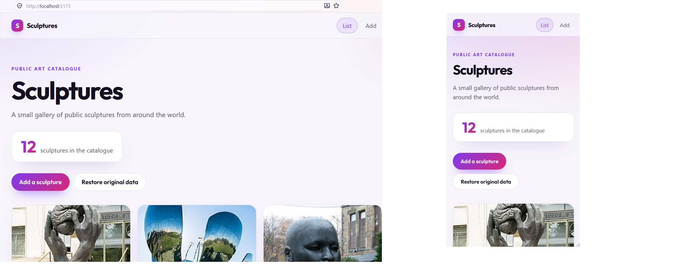

# Parte 7 — Delete

## Qué pedía esta parte

Añadir un botón de borrar en cada fila del listado que llame a `deleteSculpture(id)` del
contexto del `Outlet`.

El enunciado insiste en dos cosas:

- El borrado debe ser **inmutable**: `filter` sobre el array, nunca `splice` ni modificar el
  estado original.
- Como bonus, se puede añadir también el borrado desde el detalle y una confirmación con
  `window.confirm()`.

## Punto de partida

`deleteSculpture` existía desde la parte 4, pero no lo usaba ninguna página. La lista ya tenía
los enlaces **View** y **Edit**, así que el botón de borrar era la última pieza del CRUD.

## Implementación

En `SculptureListPage` añadí `deleteSculpture` al `useOutletContext()` y un botón dentro de
`.sculpture-actions`:

```jsx
const { sculptures, deleteSculpture } = useOutletContext()

// ...

<button
  className="button-ghost button-danger"
  type="button"
  onClick={() => deleteSculpture(sculpture.id)}
  aria-label={`Delete ${sculpture.name}`}
>
  Delete
</button>
```

Decisiones:

- **`type="button"`**: aunque ahora mismo el botón no está dentro de un formulario, dejarlo
  explícito evita que en el futuro se comporte como un botón de envío si alguien reutiliza el
  componente. Un `<button>` sin `type` dentro de un `<form>` envía el formulario.
- **Es un botón, no un enlace**: borrar no es navegar. Un `<Link to="/">` cambiaría de página
  sin ejecutar el borrado, y un `<a>` con `href="#"` ensuciaría la URL. El botón ejecuta la
  función y React vuelve a dibujar la lista.
- **`aria-label` con el nombre**: hay doce botones con el texto “Delete”. Para alguien que use
  un lector de pantalla, “Delete Homenaje a la Neurocirugía” es mucho más útil que doce
  “Delete” iguales. MDN lo explica en la referencia de `aria-label`:
  https://developer.mozilla.org/en-US/docs/Web/Accessibility/ARIA/Reference/Attributes/aria-label
- **Clase `button-danger`**: la dejo puesta como gancho para el pase visual. En este commit no
  hay reglas nuevas, así que el botón se ve como los demás `.button-ghost`.

## El handler ya era inmutable

No hizo falta tocar `App.jsx`, porque `deleteSculpture` ya estaba preparado desde la parte 4:

```jsx
function deleteSculpture(id) {
  setSculptures((current) =>
    current.filter((sculpture) => String(sculpture.id) !== String(id)),
  )
}
```

`filter` devuelve un array nuevo y no toca el anterior. Además compara los ids con `String()`
para que convivan los ids numéricos de las esculturas iniciales y los `crypto.randomUUID()` de
las que se crean desde el formulario. La documentación de React insiste en no mutar el estado:

- https://react.dev/learn/updating-arrays-in-state

## Por qué la `key` estable importa al borrar

Al borrar una escultura, React tiene que quitar **esa** tarjeta y conservar las demás. La
`key={sculpture.id}` de la parte 5 es lo que le permite identificar cada tarjeta sin ambigüedad.

Si hubiera usado el índice (`key={index}`), al eliminar la primera escultura todas las
siguientes cambiarían de índice. React podría reutilizar el nodo de la tarjeta equivocada y
mezclar la información o las animaciones. Con el id, cada tarjeta sigue siendo la misma aunque
cambie de posición. Es la misma idea de *Rendering Lists*:

- https://react.dev/learn/rendering-lists

## Fallo que evité: borrar mientras se navega

Mi primera idea fue poner el botón dentro de la tarjeta y envolver la tarjeta entera en un
`<Link>` para que fuera clicable. Eso habría sido un problema: al pulsar Delete también se
dispararía la navegación al detalle, y el usuario vería una pantalla de “not found” justo
después de borrar.

Lo dejé como estaba en la parte 5: la tarjeta no es un enlace, y las acciones (View, Edit,
Delete) son elementos independientes dentro de `.sculpture-actions`.

## Extra: restaurar el catálogo original

Al probar el borrado eché de menos poder deshacerlo sin recargar la página. Como el estado se
inicializa desde `sculptureList`, la solución es volver a copiar ese array:

```jsx
function resetSculptures() {
  setSculptures([...sculptureList])
}
```

Ese handler vive en `App.jsx`, junto a los demás, y viaja por el contexto del `Outlet` como
`resetSculptures`. En la lista añadí un botón secundario al lado de “Add a sculpture”:

```jsx
<button className="button-ghost" type="button" onClick={resetSculptures}>
  Restore original data
</button>
```

Decisiones:

- **Copia con `[...sculptureList]`**: no paso el array importado tal cual para no compartir la
  misma referencia con el módulo. El estado siempre trabaja con su propio array.
- **Restaura todo, no solo los borrados**: vuelven las doce esculturas originales, se deshacen
  las ediciones y desaparecen las esculturas creadas. Es lo que se espera de un botón que dice
  “Restore original data”.
- **`data.js` sigue siendo la fuente de verdad**: si en el futuro se añade una escultura al
  archivo, el botón también la recuperará.
- **Sin confirmación por ahora**: un clic restaura inmediatamente. Lo dejo apuntado como bonus,
  igual que la confirmación del borrado.
- **Sin estilos nuevos**: el botón reutiliza `.button-ghost`. El pase visual de la parte 7
  puede darle un tratamiento secundario si hace falta.

Comprobé que funciona después de borrar, de editar y de crear:

```
tras borrar dos: quedan 10: true
restaurar tras borrar: vuelven las 12 y los nombres originales: true
restaurar tras editar: vuelve el nombre original: true
restaurar tras crear: vuelve a 12 y desaparece la nueva: true
```

Así se ve el botón en escritorio y en ancho estrecho:



## Lo que dejo para el bonus

- **Confirmación antes de borrar** con `window.confirm()`. Ahora mismo el borrado es inmediato.
- **Confirmación antes de restaurar**, por el mismo motivo.
- **Borrar desde el detalle**, con `navigate("/")` después.
- **Estado vacío** cuando no queda ninguna escultura: la lista se queda sin tarjetas y el
  contador marca 0. No es un fallo, pero se podría mostrar una tarjeta de “no hay esculturas”.
- **Pase visual**: color de peligro para `.button-danger`, con su hover y su foco.

## Verificación

`npm run lint` y `npm run build` pasan.

Probé el borrado con Chrome headless y el protocolo de DevTools, pulsando los botones como lo
haría una persona:

```
inicio: 12 tarjetas, 12 botones Delete y contador 12: true
borrar: sigue en la lista: true
borrar: quedan 11 tarjetas y contador 11: true
borrar: la escultura desaparece: true
borrar otra: quedan 10 y desaparece: true
las tarjetas restantes conservan View/Edit/Delete: true
```

Es decir: el borrado no navega, actualiza el contador, quita la tarjeta correcta y deja intactas
las acciones de las demás. El script de prueba era temporal y lo borré.

## Fuentes

- Actualizar arrays en estado: https://react.dev/learn/updating-arrays-in-state
- Listas y `key`: https://react.dev/learn/rendering-lists
- `aria-label`: https://developer.mozilla.org/en-US/docs/Web/Accessibility/ARIA/Reference/Attributes/aria-label
